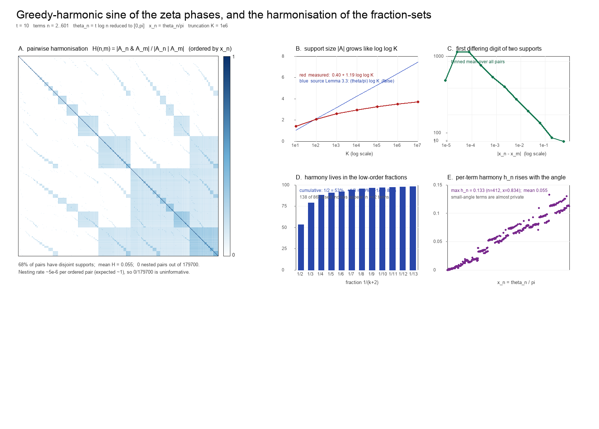

# Greedy-harmonic sine of the zeta phases, and how the fraction-sets harmonise

Companion computation to [`research-v2.md`](../../../twin-prime-parity/004/research-v2.md) §1–§3. For each term
`n^{-s}` of `ζ(σ+it)` the phase `t log n` is reduced to an angle `θ_n ∈ [0,π]`, the
greedy harmonic expansion of `x_n = θ_n/π` with alphabet `1/(k+2)` gives the **support**
`A_n = {k : δ_k(θ_n) = 1}`, the sine is reconstructed from it, and the **harmonisation**
of `A_n` with every other `A_m` is measured.

Figure: [`sine_harmonics.png`](../assets/sine_harmonics.png). Script:
[`sine_harmonics.py`](../python/sine_harmonics.py) (numpy + Pillow).



*Parameters: `t = 10`, terms `n = 2..601`, alphabet truncation `K = 10⁶`.*

---

## 1. The sine is recovered from the fractions

Each support is a finite list of unit fractions whose sum is `x_n` to within the
truncation; `sin(t log n) = ε_n sin(π Σ_{k∈A_n} 1/(k+2))`.

| `n` | `x_n = θ_n/π` | greedy fractions | `sin` (greedy) | `sin` (direct) | error | residual `r_n` |
|---|---|---|---|---|---|---|
| 2 | 0.20635600 | 1/5 + 1/158 + 1/37192 | +0.60382143 | +0.60382143 | 2.5·10⁻¹⁰ | 1.00·10⁻¹⁰ |
| 3 | 0.50300847 | 1/2 + 1/333 + 1/182771 | −0.99995534 | −0.99995534 | 2.6·10⁻¹³ | 8.89·10⁻¹² |
| 4 | 0.41271200 | 1/3 + 1/13 + 1/408 + 1/216807 | +0.96263581 | +0.96263581 | 6.2·10⁻¹² | 7.26·10⁻¹² |
| 5 | 0.87700001 | 1/2 + 1/3 + 1/23 + 1/5308 | −0.37687104 | −0.37687097 | 6.9·10⁻⁸ | 2.37·10⁻⁸ |
| 6 | 0.29665247 | 1/4 + 1/22 + 1/835 | −0.80279028 | −0.80279089 | 6.0·10⁻⁷ | 3.23·10⁻⁷ |
| 7 | 0.19402438 | 1/6 + 1/37 + 1/3025 | +0.57249465 | +0.57249493 | 2.8·10⁻⁷ | 1.09·10⁻⁷ |
| 8 | 0.61906800 | 1/2 + 1/9 + 1/126 + 1/49055 | +0.93085035 | +0.93085035 | 2.9·10⁻¹⁰ | 2.50·10⁻¹⁰ |
| 9 | 0.99398305 | 1/2 + 1/3 + 1/7 + 1/57 + 1/4021 | +0.01890174 | +0.01890168 | 6.6·10⁻⁸ | 2.11·10⁻⁸ |

The error is the truncation, not the method: it is bounded by `π·r_n` with `r_n` the
residual after the listed takes (last column), and **every** `r_n < 1/(K+2) ≈ 10⁻⁶`, so
the next greedy denominator exceeds `K = 10⁶` for all eight terms. Float64 contributes
`≤ 2·10⁻¹⁶`. The larger rows (`n = 6, 7`) are simply those whose next denominator is
only a few times `10⁶`, not `≫ 10⁶`; the quoted errors track `π r_n` to three
significant figures.

**The support size is `O(log log K)`, not the source's `(θ/π) log K`.** Measured mean
support size over the 600 terms:

| `K` | 10 | 10² | 10³ | 10⁴ | 10⁵ | 10⁶ | 10⁷ |
|---|---|---|---|---|---|---|---|
| **measured mean `\|A\|`** | 1.392 | 2.082 | 2.588 | 2.953 | 3.255 | 3.490 | 3.705 |
| source Lemma 3.3: `(θ/π) log K` | 1.064 | 2.127 | 3.191 | 4.254 | 5.318 | 6.381 | 7.445 |

The measured sequence is `0.40 + 1.19 log log K` (to two decimals over this range); the
source's selection-density law `D(N,θ) = x log N + O(1)` is **false**, and the clean way
to say why is per target: the true count is `Θ(log log K)`, so for fixed `x > 0` the
error `x log K − D(K,x) → ∞` — the `O(1)` claim fails, not merely a constant. (A
seven-point fit cannot by itself distinguish `log log K` from `log K + log log K`; the
asymptotic form and its constant are fixed by the Sylvester recurrence, not by the fit
— see below.) This is the classical Sylvester/Egyptian-fraction growth (doubly
exponential denominators ⇒ logarithmically many terms), and it numerically confirms the
programme's later `O(log log N)` finding while falsifying the source's Lemma 3.3.
*The law itself is classical and much older than the programme:* the residual after
taking `1/q` is `< 1/(q(q−1))`, so the next denominator satisfies `q_next ≥ q(q−1)` and
the expansion below `K` has `O(log log K)` terms, with asymptotic constant
`1/ln 2 = 1.4427` (Sylvester 1880; Vardi's greedy-summand theorem). The fitted slope
`1.19` is a finite-`K` artifact: at `K = 10⁷` the measurement is `3.71` against the
asymptotic `1.4427 · ln ln 10⁷ = 4.01`. The `K`-table above is therefore a numerical
check of a known theorem, not evidence about `ζ`.

## 2. Harmonisation of the fraction-sets

For two terms define the harmonisation

```
H(n,m) = |A_n ∩ A_m| / |A_n ∪ A_m|         (Jaccard overlap of the fraction-sets),
```

which is `0` for disjoint supports, `1` for identical supports, and — under the
(now disproved) monotonicity of the source — would equal `|A_n|/|A_m|` for `x_n < x_m`
(perfect nesting).

Over all `179 700` pairs:

| quantity | value |
|---|---|
| disjoint supports (`H = 0`) | 122 085 (67.9 %) |
| mean `H` | 0.0550 |
| max `H` | 0.667 |
| pairs sharing exactly 1 fraction | 50 813 |
| pairs sharing 2 / 3 / 4 fractions | 6 558 / 243 / 1 |
| **nested pairs** (`A_i ⊆ A_j` with `x_i < x_j`) | **0 of 179 700** (finite-sample; the angle-measure rate is ≈5·10⁻⁶ per ordered pair — §2b) |
| distinct supports among 600 terms | 600 |

**All the shared mass is in the low-order fractions.** Of the 64 662 pairwise
"shared-fraction tokens", by index:

| fraction | 1/2 | 1/3 | 1/4 | 1/5 | … | top 7 |
|---|---|---|---|---|---|---|
| share of tokens | 53.3 % | 25.8 % | 8.9 % | 2.6 % | … | 95.6 % |
| cumulative | 53.3 % | 79.0 % | 88.0 % | 90.5 % | … | 95.6 % |

Of the 860 distinct indices used across the ensemble, only **138 are shared by more than
one term**: the high-order fractions are essentially *private* to each term.

**Harmonisation is local in angle.** Writing `ℓ(n,m)` for the first index at which the
two supports differ:

| `\|x_n − x_m\|` | 10⁻⁵–10⁻⁴ | 10⁻⁴–10⁻³ | 10⁻³–10⁻² | 10⁻²–10⁻¹ | > 10⁻¹ |
|---|---|---|---|---|---|
| mean `ℓ` (pair-weighted over the bins) | ~2 200 | ~350 | ~54 | ~7 | ~0.7 |

Two terms whose reduced phases agree to `10⁻³` agree on hundreds of greedy digits; two
terms differing by more than `0.1` agree on at most the first digit. This is not an
empirical law but the geometry of the cell partition of §2c: two points share their
first `L` digits **iff** they lie in the same depth-`L` cell (a trie / PATRICIA
structure), so the decay of the shared prefix with `|x−y|` is automatic. The
harmonisation is a metric property of the reduced angle, **not** an arithmetic property
of `n`.

**Per-term harmony** `h_n = mean_m H(n,m)`: mean `0.055`, max `0.133` (at `n = 412`,
`x = 0.834`). Terms with small angles (`x ≲ 0.01`) have `h_n ≈ 0` — their supports are
`{k, k'}` with large private indices.

## 2b. What the numbers converge to, and why they depend on `t`

The zeta phases are equidistributed: for fixed `t ≠ 0`, `{t log n mod 2π}` is
equidistributed in `[0,2π]`, so the reduced angles `x_n` become uniform on `[0,1]` as
`M → ∞`, and every statistic above converges to its integral over the uniform angle
measure. Computing that integral directly (uniform `x`, `K = 10⁶`; marginal sums plus
exact pair enumeration at `N = 2000`, seeds 1–3, and Monte Carlo at larger `N`):

| statistic | **angle-measure limit** (uniform `x`) | zeta sample, `t = 10` |
|---|---|---|
| `E\|A\|` | 3.58 | 3.49 |
| `P(disjoint)` | 0.62 | 0.68 |
| mean `H` | 0.065 | 0.055 |
| `E\|A∩B\|` | 0.43 | 0.36 |
| `P(nested)` (two-sided) | ≈ 1·10⁻⁵ | 0 in 179 700 |

The finite sample is *not yet* at the limit, and the gap is exactly the equidistribution
rate, visible in `t` at fixed `M = 601`:

| `t` | 1 | 3 | 10 | 100 | 1234.5 |
|---|---|---|---|---|---|
| mean `\|A\|` | 2.93 | 3.34 | 3.49 | 3.58 | 3.56 |
| `P(disjoint)` | 0.897 | 0.743 | 0.679 | 0.618 | 0.625 |
| mean `H` | 0.0184 | 0.0439 | 0.0550 | 0.0650 | 0.0639 |
| nested pairs | 8 | 3 | 0 | 1 | 1 |

At `t = 1` the angles span less than one period, so the sample is far from uniform;
by `t ≈ 100` it matches the angle-measure limit to two decimals. **The harmonisation
statistics are properties of the angle measure, not of `ζ`**; the zeta phases supply an
equidistributed sample of that measure, and `t` controls the sample quality at finite
`M`.

**The zeta phases are only a sampler — the decisive control.** Running the identical
measurement at `K = 10⁶`, `M = 600` on other sequences:

| sequence | `E\|A\|` | `P(disjoint)` | mean `H` | nested |
|---|---|---|---|---|
| `{t log n}`, `t = 2.5` | 3.823 | 0.465 | 0.0957 | 0 |
| `{t log n}`, `t = 10` | 3.490 | 0.679 | 0.0550 | 0 |
| `{t log n}`, `t = 100` | 3.585 | 0.618 | 0.0650 | 1 |
| `{n√2 mod 1}` | 3.588 | 0.618 | 0.0650 | 1 |
| `{n·e mod 1}` | 3.557 | 0.618 | 0.0650 | 0 |
| i.i.d. uniform | 3.647 | 0.576 | 0.0721 | 1 |
| **angle-measure integral** | **3.58** | **0.617** | **0.065** | **~10⁻⁵** |

The zeta phases at large `t` agree with the generic equidistributed sequences `{n√2}`,
`{n·e}` and with the integral to two or three decimals; the *i.i.d. uniform* sample
deviates (`0.576` vs `0.617`), exactly because a u.d. sequence has discrepancy
`O(N^{−1/3})` (van der Corput) while i.i.d. points have `O(N^{−1/2})`. So the phase
sequence `{t log n}` is doing no work beyond being equidistributed: the title's "of the
zeta phases" is a choice of sampler, and `t` merely controls how many periods the 600
points cover.

**Correction (nesting is rare, not impossible).** The limiting nesting probability is
`≈ 1·10⁻⁵` for a random unordered pair, i.e. `≈ 5·10⁻⁶` per ordered pair — the quantity
the note's test measures. So `0` out of 179 700 is a *finite-sample zero* (expected
count `≈ 1`), not a structural impossibility. Across the `t` table the counts are
`8, 3, 0, 1, 1` — fluctuations about that small rate. The correct statement is:
**nesting occurs with probability `~5·10⁻⁶` per ordered pair, against `1` for a
monotone chain** — a gap of five to six orders of magnitude, which is what kills the
threshold/chain picture, not an absolute prohibition.

**Distinct supports do nest** — so this is *not* forced by injectivity. The exact cell
partition (indices `k` 0-based, alphabet `1/(k+2)`) gives, for an ordered pair in
**different** cells, `P(A_i ⊆ A_j) = 0.105 (K=20), 0.064 (K=40), 0.047 (K=60)`; the
trivial same-cell case contributes only `0.027, 0.013, 0.008`. Nesting of genuinely
different words therefore has positive measure and decays with `K`. (An argument that
containment is impossible confuses the *truncated* supports with the unbounded greedy
sums: with truncation at `K` the residuals `x − Σ_{k∈A(x)}1/(k+2)` differ, so
`A(x) ⊆ A(y)` does not order `x, y`.)

**Nesting decays with the truncation `K`.** The cell partition of §2c gives the
ensemble statistics *exactly* for moderate `K` (no sampling):

| `K` | 10 | 20 | 30 | 40 | 50 | 60 | 80 |
|---|---|---|---|---|---|---|---|
| `P(A_i ⊆ A_j)`, one-directional | 0.225 | 0.132 | 0.096 | 0.076 | 0.063 | 0.055 | 0.043 |
| mean `H` | 0.183 | 0.154 | 0.142 | 0.135 | 0.130 | 0.126 | 0.120 |
| `P(disjoint)` | 0.623 | 0.620 | 0.619 | 0.618 | 0.618 | 0.618 | 0.618 |
| `E\|A\|` | 1.47 | 1.72 | 1.84 | 1.92 | 1.99 | 2.04 | 2.12 |

So `P(nest)` is **not a constant**: it falls from `0.225` at `K = 10` to `0.043` at
`K = 80` (a factor `~5` over `8×` in `K`). The `K ≤ 80` trend does **not** extrapolate
to `K = 10⁶`: a log-log fit over those seven points would predict `~10⁻⁴`, while direct
measurement at `K = 10⁶` (Monte Carlo over `4·10⁶` pairs, plus exact enumeration at
`N = 2000`, seeds 1–3) gives a **two-sided** rate of `1.0–1.2·10⁻⁵`, i.e. `≈5·10⁻⁶` per
ordered pair — about `20×` below the extrapolation. The note's test is the
ordered-by-angle conditional, so the relevant rate is `≈5·10⁻⁶` and the expected nested
count in the 179 700-pair sample is `≈1`.

**The zero count is uninformative.** With `P(nested) = 5·10⁻⁶` the probability of seeing
`0` is `e^{−0.9} ≈ 0.4` (and `e^{−1.8} ≈ 0.17` if the two-sided rate is read against the
ordered test). So `0/179 700` neither confirms nor refutes the small rate; the evidence
for "not a chain" is the rate estimate, not the count. At small `K` the codewords nest
often (`P = 0.225` at `K = 10`), so the conclusion sharpens with the word length rather
than holding at all scales. `P(disjoint)` is essentially constant at `0.618`; `E|A|`
grows like `log log K`. The reported `t = 10`, `K = 10⁶` numbers are the `K = 10⁶`
column of this picture, not universal constants.

## 2c. The word map is a quantizer with polynomially many interval cells

`x ↦ W_K(x) = (δ_0(x), …, δ_{K−1}(x))` is a step function. Its breakpoints are rational
(each is a sub-sum of `1/2, 1/3, …`), so the cell partition can be computed **exactly**
in rational arithmetic by splitting each cell at `x = c + 1/(k+2)`:

| `K` | 20 | 40 | 60 | 80 | 100 | 120 | `2^K` |
|---|---|---|---|---|---|---|---|
| exact number of cells (distinct words) | 90 | 272 | 568 | 964 | 1 448 | 2 012 | 10³⁶ |
| `#cells / K^1.8` | 0.410 | 0.356 | 0.358 | 0.362 | 0.364 | 0.364 | — |

The count follows `≈ 0.364 · K^1.8` to three digits over `K = 20..120` — **polynomial,
not exponential**: at `K = 120` the word carries only `log₂ 2012 ≈ 11` bits, against the
`120` bits a free binary code could carry. So the word map is a **quantizer** of `[0,1]`
into polynomially many intervals, with resolution `Θ(1/K)`, matching the reconstruction
bound `π/(K+1)`. *(Caveat: an earlier float-based run suggested faster growth — those
counts are inflated by spurious splits once cell lengths approach machine precision;
the exact rational counts above are the ones to use, and the growth law is established
only over `K ≤ 120`.)*

Each cell is an interval; but the cells are ordered by angle and their codewords are
**not** ordered by inclusion, which is why the harmonisation is not a chain. This is the
right frame for the whole computation: a one-dimensional quantizer with interval cells
and sparse binary codewords, whose codeword-overlap structure is the "harmonisation".

**Terminology (one correction).** The phrase "injective quantizer" is an oxymoron and
should be split: the **untruncated** codeword map `x ↦ A(x)` is **injective** — the
greedy Egyptian expansion is unique and `x = Σ_{k∈A(x)} 1/(k+2)`, so equal codewords
force equal `x` — while the **`K`-truncation** `W_K` is a genuine **quantizer**,
many-to-one, with `Θ(K^1.8)` cells and resolution `Θ(1/K)`. The codeword is lossless
before truncation and lossy after it; the harmonisation statistics are about the lossy
version.

## 3. What this says

1. **The sine reconstruction works** — to `10⁻⁷`–`10⁻¹³` with ≤ 5 fractions per term at
   `K = 10⁶`, the accuracy being the truncation.
2. **The fraction-sets barely harmonise.** Two thirds of all term-pairs share no
   fraction at all; the mean overlap is `5.5 %` (`6.5 %` in the angle-measure limit);
   and the shared part is carried almost entirely by `1/2` and `1/3`.
3. **The supports are almost never nested.** Nesting has probability `~5·10⁻⁶` per
   ordered pair, against `1` for a chain — five to six orders of magnitude. The sampling
   evidence for this is the *rate estimate*, not the sample's `0/179 700`, which is
   statistically uninformative at that rate (§2b). The comparison is to the *chain*
   property of the word map, not directly to the source's threshold kernel `K(n,m)`,
   which is an integral of the selection indicators — a different object, though both
   rest on the same failed monotonicity.
4. **The source's threshold/kernel picture is therefore structurally wrong**, not
   merely mis-computed: its closed forms rest on the false Lemma 4.1. The natural object
   replacing it is the partition of `[0,1]` by the finite words `W_K(x)` — the
   piecewise-constant quantizer `x ↦ (δ_0,…,δ_{K−1})` of §2c — whose cells are intervals,
   ordered by angle, and *not* by inclusion.
5. **"Harmonisation" is the Jaccard overlap of the codewords**, `H = |A∩B|/|A∪B|`; the
   word is descriptive, and the object is a genuine metric on codeword pairs, not an
   appeal to any arithmetic meaning of "harmony". Index proximity (`n`, `m` close) is
   irrelevant; angle proximity (`x_n` close to `x_m`) controls agreement, and this is
   the geometry of the cell partition (same depth-`L` cell ⟺ same first `L` digits),
   not an empirical law. The whole analysis is a statement about the greedy Egyptian
   word map on `[0,1]`, with `ζ` entering only as the source of a convenient
   equidistributed angle sequence — as the `{n√2}` control in §2b demonstrates.

## 4. Reproduction

```bash
python3 \
    research/python/sine_harmonics.py
```

The script prints the tables above and writes `sine_harmonics.png`. Supports are
computed by the **jump form** of the greedy — from residual `r`, the next index with
`1/(k+2) ≤ r` is `k = ⌈1/r⌉ − 2` — so the cost is the number of takes
(`O(log log K)`), not `K`. Changing `T`, `M`, `KMAX` at the top of the script changes
the sample and the truncation.

*Status — NUMERICAL throughout (finite sample, `t = 10`, `n ≤ 601`). The two structural
claims it measures against the source are THEOREM-level: Lemma 3.3's density law is
false (the data diverge from it without bound, and the classical Sylvester growth
explains `log log`), and Lemma 4.1's monotonicity fails (exact counterexample
`δ_1 = 1,0,1` at `x = 1/3, 1/2, 5/6` in `research-v2.md` §1; the word ensemble nests
with probability `~5·10⁻⁶` per ordered pair, measured here).*
