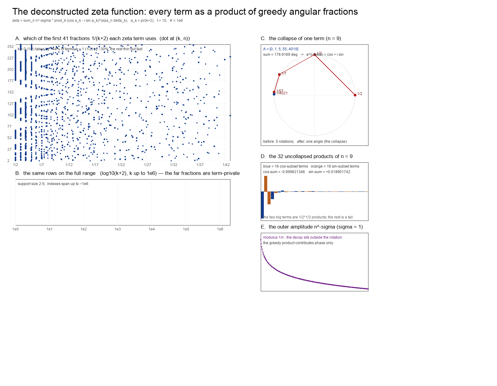

# The deconstructed zeta function: every term as a product of greedy angular fractions

This is the *pre-collapse* restatement asked for: `ζ` written entirely in terms of the
greedy angular fractions `1/(k+2)`, with the per-term angle kept as an explicit product
of elementary rotations and **not** resummed to the closed form `θ_n` (which would
return the classical term `n^{-s}`).

Companion files: script [`deconstructed_zeta.py`](deconstructed_zeta.py), figure
[`deconstructed_zeta.png`](deconstructed_zeta.png). Context: [`research-v2.md`](research-v2.md)
§1–§3, [`sine-harmonics.md`](sine-harmonics.md). The alternating-function version — the
complex Dirichlet eta at the first zeta zero, split into its cos and sin series and
displayed as greedy-harmonic boolean selectors — is
[`eta-cos-sin.md`](eta-cos-sin.md).



*Parameters: `t = 10`, `n = 2..257`, truncation `K = 10⁶`.*

---

## 1. The three equivalent pre-collapse forms

Notation: `s = σ + it`, `α_k = π/(k+2)`, `φ_n = t log n`, `θ_n ∈ [0,π]` and
`ε_n ∈ {±1}` the reduction of `φ_n` (so `e^{-iφ_n} = cos θ_n − i ε_n sin θ_n`), and
`δ_k(θ_n) ∈ {0,1}` the greedy digits on target `x_n = θ_n/π`.

**(i) Product form — one rotation per taken fraction.** For `σ > 1`,

```
                                                        ┌──────────────────────────────────────┐
 ζ(σ+it) = Σ_{n≥1} n^{−σ}  lim_{K→∞}  Π_{k=0}^{K−1}     │ ( cos α_k − i sin α_k )^{ ε_n δ_k }  │
                                                        └──────────────────────────────────────┘
```

The amplitude `n^{−σ}` sits **outside**; the product has modulus 1 and carries phase
only. This is the whole deconstruction in one line: ζ is a sum over terms of an
amplitude times a product of preselected unit rotations `e^{∓iα_k}`.

**(ii) Fusion form — the incremental version.** With `c_{n,0}=1`, `s_{n,0}=0`,

```
c_{n,k+1} = c_{n,k} cos α_k − δ_{n,k} s_{n,k} sin α_k ,
s_{n,k+1} = s_{n,k} cos α_k + δ_{n,k} c_{n,k} sin α_k ,
```

and `ζ(σ+it) = Σ_n n^{−σ} lim_K ( c_{n,K} − i ε_n s_{n,K} )`. Each step is one
elementary rotation by `α_k`, applied only when the greedy digit is 1.

**(iii) Fully expanded form — pure products of greedy sines and cosines.** Let
`A_{n,K} = {k < K : δ_k(θ_n) = 1}`. Then

```
 C_{n,K} = Σ_{S ⊆ A_{n,K},  |S| even}  (−1)^{|S|/2}      ( Π_{k∈S} sin α_k ) ( Π_{k∈A\S} cos α_k )

 S_{n,K} = Σ_{S ⊆ A_{n,K},  |S| odd }  (−1)^{(|S|−1)/2}  ( Π_{k∈S} sin α_k ) ( Π_{k∈A\S} cos α_k )
```

and

```
 ζ(σ+it) = Σ_{n≥1} n^{−σ}  lim_{K→∞} [ C_{n,K} − i ε_n S_{n,K} ] .
```

Every factor is now literally a greedy sine or cosine: `sin(π/(k+2))`, `cos(π/(k+2))`.
No angle is ever added; each term is a sum, over subsets of its greedy support, of
products of elementary factors. The object is a **triple sum**: over `n`, over subsets
`S ⊆ A_n`, and over the factors `k ∈ A_n`. Since `|A_n| ≤ 5` at `K = 10⁶`, each term is
an explicit sum of at most `2⁵ = 32` products.

## 2. Where the collapse happens (and why it is only local)

The three identities that collapse the above back to the classical term are applied
**inside each `n`**, never across `n`:

```
 C_{n,K} + i S_{n,K}  =  e^{ i θ_{n,K} }   with  θ_{n,K} = Σ_{k∈A_{n,K}} α_k   →   θ_n ,
 cos θ_n − i ε_n sin θ_n = e^{−iφ_n} = n^{−it} ,
 hence   n^{−σ} · (collapsed)  =  n^{−σ} n^{−it}  =  n^{−s} .
```

The first line is the compound-angle identity (the "collapse"); the second is the phase
reduction; the third is the classical zeta term. Nothing equivalent happens between
different `n`: the words `w_n = (δ_k(θ_n))_k` depend on `θ_n = t log n mod 2π`, so the
terms do not share a common factor structure. The global object stays a sum over `n` of
independently-expanded products.

## 3. What it looks like

**The deconstruction data is a `n × k` word matrix.** Panel A of the figure is the
matrix `(δ_k(θ_n))` for `n = 2..257` over the first 41 fractions; panel B is the same
over the full range to `k ≈ 10⁶`. `1/2` (`k = 0`) is taken by ≈44 % of terms and `1/3`
(`k = 1`) by ≈30 %; the higher fractions thin out and are essentially private to single
terms — 68 % of the `t = 10` term-pairs (62 % in the angle-measure limit) share no
fraction at all, see [`sine-harmonics.md`](sine-harmonics.md) §2. The matrix is the
entire phase content of ζ, term by term.

**One term, explicitly uncollapsed.** For `n = 9` (`A = {0,1,5,55,4019}`,
`α = 90°, 60°, 180/7°, 180/57°, 180/4021°`, total `178.9169°`):

| | dominant products (of 16) | value | subset |
|---|---|---|---|
| `C` (cos-sum, even subsets) | `− sin α₀ sin α₁ cos α₅ cos α₅₅ cos α₄₀₁₉` | −0.7791 | `{0,1}` |
| | `− sin α₀ sin α₅ cos α₁ cos α₅₅ cos α₄₀₁₉` | −0.2166 | `{0,5}` |
| | `− sin α₀ sin α₅₅ …` | −0.0248 | `{0,55}` |
| `S` (sin-sum, odd subsets) | `+ sin α₀ cos α₁ cos α₅ cos α₅₅ cos α₄₀₁₉` | +0.4498 | `{0}` |
| | `− sin α₀ sin α₁ sin α₅ cos α₅₅ cos α₄₀₁₉` | −0.3752 | `{0,1,5}` |
| | `− sin α₀ sin α₁ sin α₅₅ …` | −0.0430 | `{0,1,55}` |

with `Σ C = −0.999821346`, `Σ S = +0.018901742` — i.e. `cos θ₉ ≈ −1`, `sin θ₉ ≈ 0.019`.
The uncollapsed object is thus a **massively cancelling** sum: `16` products of modulus
at most `0.78` resum to `−1`, and `16` more resum to `0.019`. The collapse (angle
addition) is exactly that resummation; before it, the term is a signed subset sum.

**Assembly table** (each row is one `n`, before collapse; the last column is the
`2^{|A|}` count of products that make up that term):

| `n` | support `k` | fractions `1/(k+2)` | `Σ α_k` | `(cos θ, sin θ)` collapsed | products |
|---|---|---|---|---|---|
| 2 | 3, 156, 37190 | 1/5 + 1/158 + 1/37192 | 37.1441° | (0.797120, 0.603821) | 8 |
| 3 | 0, 331, 182769 | 1/2 + 1/333 + 1/182771 | 90.5415° | (−0.009451, 0.999955) | 8 |
| 4 | 1, 11, 406, 216805 | 1/3 + 1/13 + 1/408 + 1/216807 | 74.2882° | (0.270799, 0.962636) | 16 |
| 5 | 0, 1, 21, 5306 | 1/2 + 1/3 + 1/23 + 1/5308 | 157.8600° | (−0.926266, 0.376871) | 16 |
| 9 | 0, 1, 5, 55, 4019 | 1/2 + 1/3 + 1/7 + 1/57 + 1/4021 | 178.9169° | (−0.999821, 0.018902) | 32 |

Every entry was verified two ways: the subset sums (iii) reproduce `cos θ_{n,K}` and
`sin θ_{n,K}` to `10⁻¹²`, and the product form (i) reproduces `n^{−s}` to the truncation
error `π/(K+1)`.

**The amplitude stays outside.** Panel E: the modulus `n^{−σ}` is a separate factor per
term (for `σ = 1`, `1/n`), untouched by the collapse. So the deconstructed ζ is a sum of
"amplitude × word-expanded phase", and the two ingredients never mix.

## 4. What this is, stated plainly

```
 ζ(σ+it)  =  Σ_{n≥1}  n^{−σ}  ·  ( a signed sum of ≤ 2^{|A_n|}
                 products of sin(π/(k+2)) and cos(π/(k+2)) over the greedy support A_n ) .
```

Before the angle-addition collapse, ζ is a **global sum over terms of local
subset-sums of elementary greedy sines and cosines**. After the collapse of each term it
is the classical Dirichlet series. Both statements are exact; the interest, if any, is in
the intermediate object — the family of words `{w_n}` and the elementary products they
select.

**Limits, stated honestly.** (a) For `σ ≤ 1` the outer sum diverges (the `1/n` case sits
on the abscissa of convergence), so the identity above requires `σ > 1` or the eta
regularisation of [`research-v2.md`](research-v2.md) §3.3; the *deconstruction itself* is
per term and unconditional. (b) The words `w_n` depend on `t` and on truncation `K`;
there is no `t`-free "deconstruction of ζ". (c) The elementary factors are the classical
Sylvester/Egyptian expansion of `x_n` — nothing here is new mathematics; it is the
pre-collapse presentation of the object in `research-v2.md`.

## 5. Reproduction

```bash
/Users/victor/.dsh/dsh-runtimes/dsh-primary-runtime/dependencies/python/bin/python3 \
    research/twin-prime-parity/004/deconstructed_zeta.py
```

Prints the per-term supports, angle sums and collapsed values, and writes the figure.
The subset expansion (iii) was checked independently for `n = 2, 3, 4, 5, 9` against
`cos θ_{n,K}` and `sin θ_{n,K}` (agreement `10⁻¹²`).

*Status: the identities (i)–(iii) are THEOREM (compound-angle expansion + the source's
reconstruction theorem); the tables and figure are NUMERICAL (`t = 10`, `K = 10⁶`); the
"word matrix" observation is the same object as `sine-harmonics.md` §2c (the greedy word
map), viewed over terms instead of over angles.*
