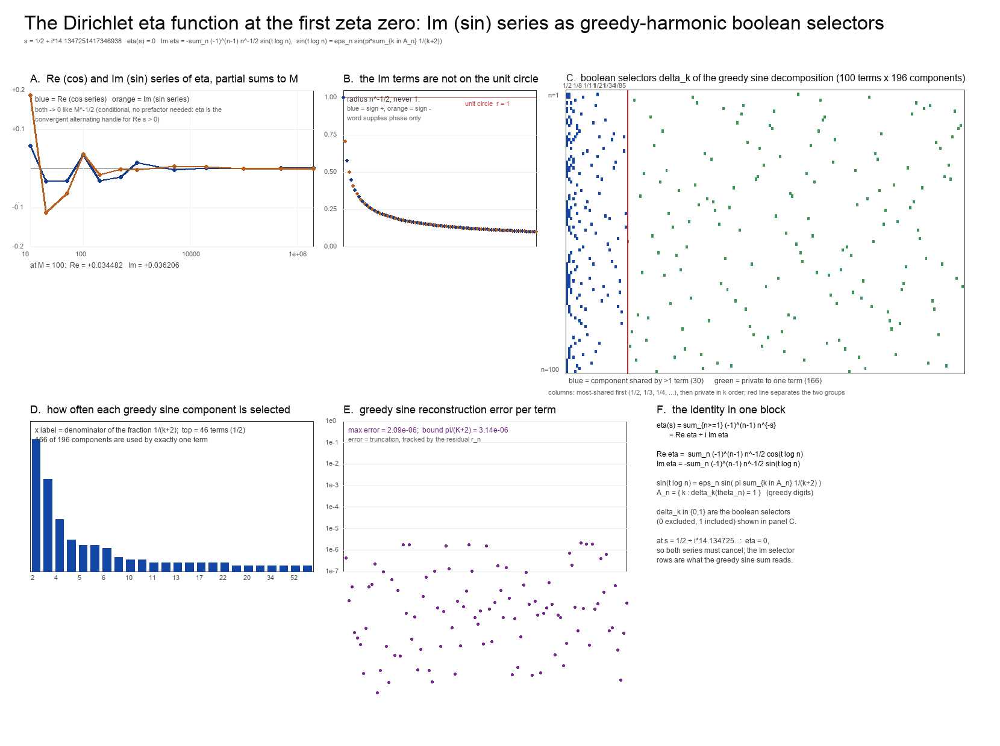

# The complex Dirichlet eta function at the first zeta zero: the Re (cos) / Im (sin) split and the Im greedy-harmonic sine selectors

Companion to [`sine-harmonics.md`](sine-harmonics.md) (the greedy sine of the zeta
phases) and [`deconstructed-zeta.md`](deconstructed-zeta.md) (the pre-collapse product
form). This note changes the *function*: instead of the Dirichlet series `Σ n^{−s}` it
uses the **alternating (Dirichlet eta) series** `Σ (−1)^{n−1} n^{−s}`, which is the
convergent handle on the critical line, splits it into its **real (cos)** and
**imaginary (sin)** series, expands each Im term into its greedy-harmonic sine
decomposition, and collects the selected greedy sines into a **boolean selector matrix**
for the first 100 terms at the **first zeta zero** `s = 1/2 + iγ₁`.

Figure: [`eta_cos_sin.png`](eta_cos_sin.png). Script: [`eta_cos_sin.py`](eta_cos_sin.py)
(numpy + Pillow). Full 100 × 196 selector matrix:
[`eta_selectors.tsv`](eta_selectors.tsv). Interactive version with `Re`/`Im` sliders:
[`eta_selectors.html`](eta_selectors.html).



*Parameters: `s = 1/2 + i·14.134725141734693790…`, terms `n = 1..100`, alphabet
truncation `K = 10⁶`.*

---

## 1. The eta function and its Re (cos) / Im (sin) split

The complex Dirichlet eta function is

```
η(s) = Σ_{n≥1} (−1)^{n−1} n^{−s} = (1 − 2^{1−s}) ζ(s)        (s ≠ 1),
```

an entire function, convergent for `Re s > 0` by Dirichlet's test — this is
[`research-v2.md`](research-v2.md) §3.3, eq. (3.3), and is the object used there to
regularise the `σ ≤ 1` strip. Writing `s = σ + it`, `φ_n = t log n`, and

```
n^{−s} = n^{−σ} e^{−i t log n} = n^{−σ} ( cos φ_n − i sin φ_n ),
```

the series separates cleanly into a **cos series** and a **sin series**:

```
Re η(σ+it) =  Σ_{n≥1} (−1)^{n−1} n^{−σ} cos(t log n)          (cos series)
Im η(σ+it) = −Σ_{n≥1} (−1)^{n−1} n^{−σ} sin(t log n)          (sin series)
```

The `n = 1` term is `+1` and contributes only to the cos series (`log 1 = 0`).

**The point of the alternating sign.** At the first zero the weight is `σ = 1/2`, and
the plain Dirichlet series `Σ n^{−s}` diverges there; the eta series is exactly the
convergent alternating handle. That is why this note is about `η` and not `ζ`.

## 2. The target: the first zeta zero

```
γ₁ = 14.134725141734693790457251983562470270784257115699…,    s = 1/2 + i γ₁.
```

At a nontrivial zero `ζ(γ₁) = 0`, while `1 − 2^{1−s} = 1 − 2^{1/2 − iγ₁}` has modulus
`|1 − 2^{1/2−iγ₁}| ≥ √2 − 1 > 0`, so `η(γ₁) = 0` as well. An independent high-accuracy
evaluation by the **Euler transform** of the alternating series
(`Σ(−1)^n a_n = Σ_k Δ^k a_0/2^{k+1}`, `a_n = (n+1)^{−s}`) confirms this:

| quantity | Euler transform | exact |
|---|---|---|
| `η(2)` | `0.822467033424113` | `π²/12 = 0.822467033424113` |
| `η(1)` | `0.693147180559945` | `log 2 = 0.693147180559945` |
| `η(1/2 + iγ₁)` | `4.26·10⁻¹⁴ − 4.08·10⁻¹⁴ i` | `0` |

So both series must sum to zero in the limit. The first-100-term partial sums do
**not** vanish — the tail at `σ = 1/2` is `O(M^{−1/2})`:

| `M` | `Re η_M` | `Im η_M` | `\|η_M\|` |
|---|---|---|---|
| 10 | 0.0580830095 | 0.1866627372 | 1.95·10⁻¹ |
| 20 | −0.0336458144 | −0.1123400165 | 1.17·10⁻¹ |
| 50 | −0.0315151129 | −0.0636795330 | 7.11·10⁻² |
| **100** | **0.0344818362** | **0.0362057806** | **5.00·10⁻²** |
| 500 | −0.0222198673 | −0.0024242998 | 2.24·10⁻² |
| 2 000 | −0.0037661613 | 0.0059842400 | 7.07·10⁻³ |
| 20 000 | 0.0006418417 | 0.0034767410 | 3.54·10⁻³ |
| 500 000 | 0.0007014074 | −0.0000895944 | 7.07·10⁻⁴ |
| 2 000 000 | 0.0002273394 | −0.0002707707 | 3.54·10⁻⁴ |

The `M = 100` row is the object the selectors below describe. The zeros are a property
of the infinite cancellation, not of these 100 terms.

## 3. The Im terms are not on the unit circle

The phase point `e^{−iφ_n} = (cos φ_n, −sin φ_n)` lies on the unit circle, but the
**term** of the eta series does not:

```
term_n = (−1)^{n−1} n^{−σ} e^{−i φ_n},        |term_n| = n^{−σ} = n^{−1/2},
```

a radius in `(0, 1]` (at `n = 100`, `0.1`). The greedy harmonic expansion is a
statement about the **phase** `θ_n` alone — the word `w_n = (δ_k(θ_n))_k` is a function
of `θ_n` — so the radial weight `n^{−σ}` and the alternating sign must be carried
**outside** the word. This is the "word is amplitude-blind, term map is not" point of
[`research-v2.md`](research-v2.md) §5.1.

Dropping the weight is not a harmless rescaling: the unit-circle version
`Σ (−1)^{n−1} sin(φ_n)` does not converge —

| `M` | 10 | 50 | 100 | 500 | 2 000 | 10 000 |
|---|---|---|---|---|---|---|
| `Σ_{n≤M} (−1)^{n−1} sin φ_n` (r ≡ 1) | −0.6759 | +0.3870 | −0.4288 | −0.0115 | −0.3587 | +0.4253 |
| `Im η_M` (r = n^{−1/2}) | +0.1867 | −0.0637 | +0.0362 | −0.0024 | +0.0066 | −0.0049 |

The `n^{−1/2}` radius is exactly what makes the Im series converge; the greedy sines
supply the phase and are multiplied by it.

## 4. Greedy-harmonic sine decomposition of each Im term

Reduce `φ_n` to `θ_n ∈ [0, π]` with `ε_n ∈ {±1}` (`e^{−iφ_n} = cos θ_n − i ε_n sin θ_n`),
so `sin φ_n = ε_n sin θ_n`. Run the greedy (Sylvester) expansion of `x_n = θ_n/π` on
the alphabet `1/(k+2)`:

```
δ_k(θ_n) = 1  ⟺  θ_n − θ_{n,k} ≥ π/(k+2),     A_n = { k : δ_k(θ_n) = 1 },
x_n = Σ_{k∈A_n} 1/(k+2)   (to the truncation residual r_n < π/(K+2)).
```

Then, by the reconstruction theorem of [`sine-harmonics.md`](sine-harmonics.md) §1,

```
sin(t log n) = ε_n sin( π Σ_{k∈A_n} 1/(k+2) ) = ε_n sin( Σ_{k∈A_n} π/(k+2) ),
```

and the Im series becomes a weighted sum of **greedy sines**:

```
Im η(σ+it) = − Σ_{n≥1} (−1)^{n−1} n^{−σ} ε_n sin( π Σ_{k∈A_n} 1/(k+2) ).
```

Equivalently, in the fully expanded odd-subset form of
[`deconstructed-zeta.md`](deconstructed-zeta.md) §1(iii), each Im term is a signed sum
of products of elementary greedy sines and cosines, `sin α_k = sin(π/(k+2))`:

```
ε_n sin θ_{n,K} = Σ_{S ⊆ A_n, |S| odd} (−1)^{(|S|−1)/2} ( Π_{k∈S} sin α_k )( Π_{k∈A_n\S} cos α_k ).
```

The **selection** — which elementary greedy sines appear — is entirely the 0/1 word
`(δ_k(θ_n))_k`. The amplitude, the alternating sign and `ε_n` sit outside. The
decomposition is exact only in the untruncated limit; at `K = 10⁶` the reconstruction
error is the residual `π r_n ≤ π/(K+2) ≈ 3.1·10⁻⁶`, and the measured maximum over the
100 terms is `2.09·10⁻⁶`, with `max r_n = 9.76·10⁻⁷`. Over the 100 terms the mean
support size is `|A_n| = 3.59` (max 5), i.e. the usual `O(log log K)` Sylvester growth.

**Worked rows** (`t = γ₁`, `K = 10⁶`; the sign `ε_n` is the column `eps`):

| `n` | `φ_n mod 2π` | `ε_n` | `x_n = θ_n/π` | `A_n` | `Σ 1/(k+2)` | `sin φ_n` direct | `sin` greedy | error | weight `(−1)^{n−1}n^{−1/2}` |
|---|---|---|---|---|---|---|---|---|---|
| 1 | 0.0000000000 | +1 | 0.00000000 | — | 0.00000000 | 0.00000000 | 0.00000000 | 0 | +1.000000 |
| 2 | 3.5142595728 | −1 | 0.88137644 | 0, 1, 19, 2357 | 0.88137629 | −0.36410058 | −0.36410101 | 4.3·10⁻⁷ | −0.707107 |
| 3 | 2.9622121233 | +1 | 0.94290140 | 0, 1, 8, 103, 22592 | 0.94290140 | +0.17842008 | +0.17842008 | 4.4·10⁻⁹ | +0.577350 |
| 4 | 0.7453338384 | +1 | 0.23724713 | 3, 25, 4758 | 0.23724712 | +0.67821717 | +0.67821715 | 1.9·10⁻⁸ | −0.500000 |
| 5 | 3.8994066034 | −1 | 0.75878033 | 0, 2, 112, 119074 | 0.75878033 | −0.68733527 | −0.68733527 | 1.4·10⁻¹⁰ | +0.447214 |
| 6 | 0.1932863889 | +1 | 0.06152497 | 15, 369, 166077 | 0.06152497 | +0.19208512 | +0.19208512 | 8.0·10⁻¹¹ | −0.408248 |
| 7 | 2.3721638787 | +1 | 0.75508321 | 0, 2, 195, 141399 | 0.75508321 | +0.69572504 | +0.69572504 | 4.0·10⁻¹¹ | +0.377964 |
| 8 | 4.2595934112 | −1 | 0.64412931 | 0, 5, 785, 659980 | 0.64412931 | −0.89922761 | −0.89922761 | 1.8·10⁻¹² | −0.353553 |
| 9 | 5.9244242466 | −1 | 0.11419719 | 7, 323, 109191 | 0.11419719 | −0.35111444 | −0.35111444 | 2.3·10⁻¹⁰ | +0.333333 |
| 10 | 1.1304808690 | +1 | 0.35984324 | 1, 36, 5150 | 0.35984322 | +0.90461725 | +0.90461723 | 2.0·10⁻⁸ | −0.316228 |
| 11 | 2.4776640638 | +1 | 0.78866497 | 0, 2, 24, 4914 | 0.78866496 | +0.61621567 | +0.61621569 | 2.5·10⁻⁸ | +0.301511 |
| 12 | 3.7075459617 | −1 | 0.81985147 | 0, 2, 13, 312 | 0.81985138 | −0.53622073 | −0.53622096 | 2.3·10⁻⁷ | −0.288675 |

(The script prints all 100 rows.) Summing with the weights reproduces the `M = 100`
row of §2: direct `Re η₁₀₀ = 0.0344818362`, `Im η₁₀₀ = 0.0362057806`; greedy
reconstruction `0.0344816085` and `0.0362056268`, agreeing to `2.3·10⁻⁷` — the
greedy truncation, not the method.

### 4a. The sine expansion, fully unrolled for one term

The expansion above is the collapsed form. Unrolling one term shows what "greedy
harmonic sine decomposition" means concretely. For `n = 2` the support is
`A₂ = {0, 1, 19, 2357}` (`1/2 + 1/3 + 1/21 + 1/2359`), so `|A₂| = 4` and the sine part
`S` is a sum of `2³ = 8` **odd-subset sine products**, grouped here by the sine-factor
set `S` and ordered by magnitude:

| `S` (sine factors) | `A₂ \ S` (cosine factors) | term `(−1)^{(\|S\|−1)/2} Π sin · Π cos` |
|---|---|---|
| {0} | {1, 19, 2357} | **+0.494414975** |
| {0, 1, 19} | {2357} | **−0.129074274** |
| {0, 1, 2357} | {19} | −0.001140445 |
| {0, 19, 2357} | {1} | −0.000099243 |
| {1} | {0, 19, 2357} | +0.000000000 |
| {19} | {0, 1, 2357} | +0.000000000 |
| {2357} | {0, 1, 19} | +0.000000000 |
| {1, 19, 2357} | {0} | −0.000000000 |
| **Σ `S`** | | **+0.364101012** |

Since `ε₂ = −1`, `sin φ₂ = −Σ S = −0.364101012`, against the direct `−0.364100585`
(difference `4.3·10⁻⁷`). The companions `{1}, {19}, {2357}` vanish because `1/2 ∈ A₂`
contributes the factor `cos(α₀) = cos(π/2) = 0` whenever `0` is not a sine factor: the
leading `1/2` dominates, and the whole `S` is essentially one product. The same
pattern holds for every term — the sine sum is a **massively cancelling** collection
of products, and the selection of which elementary sines appear is the word
`(δ_k(θ_n))_k`. The smallest listed component `1/2359` enters through
`sin(π/2359) ≈ 1.33·10⁻³` and produces the `−0.00114` term; the *omitted* tail beyond
`K = 10⁶` is what bounds the truncation at `π/(K+2) ≈ 3·10⁻⁶`.

## 5. The boolean selectors for the first 100 terms

Collect the union of all greedy sines used by the first 100 terms. There are
**196 distinct components** `1/(k+2)` (indices `k` from 0 to 921 451). They split into

* **30 components shared by more than one term**, and
* **166 components private to exactly one term**.

The most-shared components (`fraction : #terms of the 100`):

```
1/2:46  1/3:32  1/4:18  1/7:11  1/5:9  1/8:9  1/6:8  1/9:5  1/10:4  1/16:4
1/11:3  1/12:3  1/13:3  1/15:3  1/17:3  1/21:3  1/22:3  1/14:2  1/20:2  1/26:2
1/34:2  1/42:2  1/52:2  1/62:2  1/63:2  1/85:2  1/121:2  1/133:2  1/555:2  1/7718:2
```

This is the same concentration seen in [`sine-harmonics.md`](sine-harmonics.md) §2:
`1/2` is the dominant shared component (here 46 % of the 100 terms), `1/3` next
(32 %), then `1/4` (18 %); the high-order fractions are essentially private.

### 5a. The shared-component selector matrix (100 terms × 30 components)

Columns are the 30 shared components in **decreasing frequency** (most-shared first);
a `1` means the greedy sine `sin(π/(k+2))` is included in that term's decomposition of
`sin(t log n)`, a `0` that it is excluded. The header row gives the denominator `d` of
the fraction `1/d`; the column order is
`1/2, 1/3, 1/4, 1/7, 1/5, 1/8, 1/6, 1/9, 1/10, 1/16, 1/11, 1/12, 1/13, 1/15, 1/17, 1/21, 1/22, 1/14, 1/20, 1/26, 1/34, 1/42, 1/52, 1/62, 1/63, 1/85, 1/121, 1/133, 1/555, 1/7718`.

```
  n    2  3  4  7  5  8  6  9 10 16 11 12 13 15 17 21 22 14 20 26 34 42 52 62 63 851211335557718
     ------------------------------------------------------------------------------------------
   1   0  0  0  0  0  0  0  0  0  0  0  0  0  0  0  0  0  0  0  0  0  0  0  0  0  0  0  0  0  0
   2   1  1  0  0  0  0  0  0  0  0  0  0  0  0  0  1  0  0  0  0  0  0  0  0  0  0  0  0  0  0
   3   1  1  0  0  0  0  0  0  1  0  0  0  0  0  0  0  0  0  0  0  0  0  0  0  0  0  0  0  0  0
   4   0  0  0  0  1  0  0  0  0  0  0  0  0  0  0  0  0  0  0  0  0  0  0  0  0  0  0  0  0  0
   5   1  0  1  0  0  0  0  0  0  0  0  0  0  0  0  0  0  0  0  0  0  0  0  0  0  0  0  0  0  0
   6   0  0  0  0  0  0  0  0  0  0  0  0  0  0  1  0  0  0  0  0  0  0  0  0  0  0  0  0  0  0
   7   1  0  1  0  0  0  0  0  0  0  0  0  0  0  0  0  0  0  0  0  0  0  0  0  0  0  0  0  0  0
   8   1  0  0  1  0  0  0  0  0  0  0  0  0  0  0  0  0  0  0  0  0  0  0  0  0  0  0  0  0  0
   9   0  0  0  0  0  0  0  1  0  0  0  0  0  0  0  0  0  0  0  0  0  0  0  0  0  0  0  0  0  0
  10   0  1  0  0  0  0  0  0  0  0  0  0  0  0  0  0  0  0  0  0  0  0  0  0  0  0  0  0  0  0
  11   1  0  1  0  0  0  0  0  0  0  0  0  0  0  0  0  0  0  0  1  0  0  0  0  0  0  0  0  0  0
  12   1  0  1  0  0  0  0  0  0  0  0  0  0  1  0  0  0  0  0  0  0  0  0  0  0  0  0  0  0  0
  13   0  1  0  0  0  1  0  0  0  0  0  0  0  0  0  0  0  0  0  0  0  0  0  0  0  0  0  0  0  0
  14   0  0  0  0  0  1  0  0  0  0  0  0  0  0  0  0  0  0  0  0  0  0  0  0  0  0  0  0  0  0
  15   0  0  0  0  0  0  1  0  0  0  0  0  0  0  0  0  0  0  0  0  0  0  0  0  0  0  0  0  0  0
  16   0  1  0  0  0  1  0  0  0  0  0  0  0  0  0  0  0  0  0  0  0  0  0  1  0  0  0  0  0  0
  17   1  0  0  0  1  0  0  0  0  0  0  0  0  0  0  0  1  0  0  0  0  0  0  0  0  0  0  0  1  0
  18   1  1  0  1  0  0  0  0  0  0  0  0  0  0  0  0  0  0  0  0  0  0  1  0  0  0  0  0  0  0
  19   1  0  1  0  0  0  0  0  0  0  0  0  0  0  0  0  0  0  0  0  0  0  0  0  0  0  0  0  0  0
  20   1  0  0  0  0  0  0  0  0  0  0  0  0  0  0  0  0  0  0  0  0  0  0  0  0  0  0  0  0  0
  21   0  0  1  0  0  0  0  0  0  0  0  0  0  0  0  0  0  0  1  0  0  0  0  0  0  0  0  0  0  0
  22   0  0  0  0  0  0  0  0  0  0  1  0  0  0  0  0  0  0  0  0  0  0  0  0  0  0  0  0  1  0
  23   0  0  0  0  0  0  0  0  1  0  0  0  0  0  0  0  0  0  0  0  0  0  0  0  0  0  0  0  0  0
  24   0  0  1  0  0  0  0  0  0  0  0  0  0  0  0  1  0  0  0  0  0  0  0  0  0  0  0  0  0  0
  25   0  1  0  1  0  0  0  0  0  0  0  0  0  0  0  0  0  0  0  0  0  0  0  0  0  0  0  0  0  0
  26   1  0  0  1  0  0  0  0  0  0  0  0  0  0  0  0  0  0  0  0  0  0  0  0  1  0  0  0  0  0
  27   1  0  1  0  0  0  0  0  0  0  0  0  1  0  0  0  0  0  0  0  0  0  0  0  0  0  0  0  0  0
  28   1  1  0  1  0  0  0  0  0  0  0  0  0  0  0  0  0  0  0  0  0  0  0  1  0  0  0  0  0  0
  29   1  1  0  0  0  0  0  0  0  0  0  0  0  0  0  0  0  0  0  0  0  0  0  0  0  0  0  0  0  0
  30   1  0  0  0  0  0  1  0  0  0  0  0  0  0  0  0  0  0  0  0  0  0  0  0  0  0  0  0  0  0
  31   1  0  0  0  0  0  0  0  0  0  0  0  0  0  0  1  0  0  0  0  0  0  0  0  0  0  0  0  0  0
  32   0  1  0  0  0  0  0  0  0  0  0  0  0  0  0  0  0  1  0  0  0  0  0  0  0  0  0  0  0  0
  33   0  0  1  0  0  0  0  0  0  0  0  0  0  0  0  0  0  0  0  0  0  0  0  0  0  0  0  0  0  0
  34   0  0  0  0  0  1  0  0  0  0  0  0  0  0  0  0  0  0  0  0  0  0  0  0  0  0  0  0  0  0
  35   0  0  0  0  0  0  0  0  0  0  0  0  0  0  0  0  0  0  0  0  0  0  0  0  0  0  0  0  0  0
  36   0  0  0  0  0  0  0  1  0  0  0  0  0  0  0  0  0  0  0  0  0  0  0  0  0  0  0  0  0  0
  37   0  0  0  0  1  0  0  0  0  0  0  0  0  0  0  0  1  0  0  0  0  0  0  0  0  0  0  0  0  0
  38   0  1  0  0  0  0  0  0  0  0  0  0  0  0  0  0  0  0  0  0  0  0  0  0  0  0  0  0  0  0
  39   0  1  0  1  0  0  0  0  0  0  0  0  0  0  0  0  0  0  0  0  0  0  0  0  0  0  0  0  0  0
  40   1  0  0  0  0  0  0  0  0  0  1  0  0  0  0  0  0  0  0  0  0  0  0  0  0  0  0  0  0  0
  41   1  0  0  0  1  0  0  0  0  0  0  0  0  0  0  0  0  0  0  0  0  0  0  0  0  0  0  0  0  0
  42   1  0  1  0  0  0  0  0  0  1  0  0  0  0  0  0  0  0  0  0  0  0  0  0  0  0  0  0  0  0
  43   1  1  0  0  0  0  0  0  0  0  0  1  0  0  0  0  0  0  0  0  0  0  0  0  0  0  0  0  0  0
  44   1  1  0  0  0  1  0  0  0  0  0  0  0  0  0  0  0  0  0  0  0  0  0  0  0  0  0  0  0  1
  45   1  1  0  0  0  0  0  0  0  0  0  0  0  0  0  0  0  0  0  1  0  0  0  0  0  0  0  0  0  0
  46   1  0  1  0  0  0  0  0  0  0  0  0  0  0  0  0  0  0  0  0  0  1  0  0  0  0  0  0  0  0
  47   1  0  0  0  0  0  1  0  0  0  0  0  0  0  0  0  0  0  0  0  0  0  0  0  0  0  0  0  0  0
  48   1  0  0  0  0  0  0  0  0  0  0  0  1  0  0  0  0  0  0  0  0  0  0  0  0  0  0  0  0  0
  49   0  1  0  1  0  0  0  0  0  0  0  0  0  0  0  0  0  0  0  0  0  0  0  0  0  0  0  0  0  1
  50   0  1  0  0  0  0  0  0  0  1  0  0  0  0  0  0  0  0  0  0  0  0  0  0  0  0  0  0  0  0
  51   0  0  1  0  0  0  0  0  0  0  0  0  0  0  1  0  0  0  0  0  0  0  0  0  0  0  0  0  0  0
  52   0  0  0  0  1  0  0  0  0  0  0  0  0  0  0  0  0  0  0  0  0  0  0  0  0  0  0  0  0  0
  53   0  0  0  0  0  1  0  0  0  0  0  0  0  0  0  0  0  0  0  0  0  0  0  0  0  1  0  0  0  0
  54   0  0  0  0  0  0  0  0  0  0  0  0  0  0  0  0  0  0  0  0  0  0  0  0  0  0  0  0  0  0
  55   0  0  0  0  0  0  0  0  0  0  0  0  0  0  0  0  0  0  0  0  1  0  0  0  0  0  0  0  0  0
  56   0  0  0  0  0  0  0  0  1  0  0  0  0  0  0  0  0  0  0  0  0  0  0  0  0  0  0  0  0  0
  57   0  0  0  0  0  0  1  0  0  0  0  0  0  0  0  0  0  0  0  0  0  1  0  0  0  0  0  0  0  0
  58   0  0  1  0  0  0  0  0  0  0  0  0  0  0  0  0  0  0  0  0  0  0  0  0  0  0  0  0  0  0
  59   0  1  0  0  0  0  0  0  0  0  0  0  0  0  0  0  0  0  0  0  0  0  0  0  0  0  0  0  0  0
  60   0  1  0  0  0  0  0  0  0  0  0  1  0  0  0  0  0  0  0  0  0  0  0  0  0  0  0  0  0  0
  61   0  1  0  1  0  0  0  0  0  0  0  0  0  0  0  0  0  0  0  0  0  0  1  0  0  0  0  0  0  0
  62   1  0  0  0  0  0  0  0  0  0  0  0  0  1  0  0  0  0  0  0  0  0  0  0  0  0  0  0  0  0
  63   1  0  0  0  0  1  0  0  0  0  0  0  0  0  0  0  0  0  0  0  0  0  0  0  1  0  0  0  0  0
  64   1  0  0  0  1  0  0  0  0  0  0  0  0  0  0  0  0  0  0  0  0  0  0  0  0  0  0  0  0  0
  65   1  0  1  0  0  0  0  0  0  0  0  0  0  0  0  0  0  0  0  0  0  0  0  0  0  0  0  0  0  0
  66   1  1  0  0  0  0  0  0  0  0  0  0  0  0  0  0  0  0  0  0  0  0  0  0  0  0  0  0  0  0
  67   1  1  0  0  0  0  0  0  0  0  0  1  0  0  0  0  0  0  0  0  0  0  0  0  0  0  0  0  0  0
  68   1  1  0  1  0  0  0  0  0  0  0  0  0  0  0  0  0  0  0  0  0  0  0  0  0  0  1  0  0  0
  69   1  1  0  0  0  0  0  1  0  0  0  0  0  0  0  0  0  0  0  0  0  0  0  0  0  0  0  0  0  0
  70   1  1  0  0  0  0  0  0  0  0  0  0  0  0  0  0  0  0  1  0  0  0  0  0  0  0  0  0  0  0
  71   1  0  1  0  0  0  0  0  0  0  0  0  0  1  0  0  0  0  0  0  0  0  0  0  0  0  0  0  0  0
  72   1  0  1  0  0  0  0  0  0  0  0  0  0  0  0  0  0  0  0  0  0  0  0  0  0  0  1  0  0  0
  73   1  0  0  0  0  0  1  0  0  0  0  0  0  0  0  0  0  0  0  0  1  0  0  0  0  0  0  0  0  0
  74   1  0  0  0  0  1  0  0  0  0  0  0  0  0  0  0  0  0  0  0  0  0  0  0  0  0  0  0  0  0
  75   1  0  0  0  0  0  0  0  0  0  0  0  0  0  0  0  0  1  0  0  0  0  0  0  0  0  0  0  0  0
  76   1  0  0  0  0  0  0  0  0  0  0  0  0  0  0  0  0  0  0  0  0  0  0  0  0  0  0  0  0  0
  77   0  1  0  0  0  0  0  1  0  0  0  0  0  0  0  0  0  0  0  0  0  0  0  0  0  1  0  0  0  0
  78   0  1  0  0  0  0  0  0  0  1  0  0  0  0  0  0  0  0  0  0  0  0  0  0  0  0  0  0  0  0
  79   0  1  0  0  0  0  0  0  0  0  0  0  0  0  0  0  0  0  0  0  0  0  0  0  0  0  0  1  0  0
  80   0  0  1  0  0  0  0  0  0  0  0  0  0  0  0  0  0  0  0  0  0  0  0  0  0  0  0  0  0  0
  81   0  0  0  0  1  0  0  0  0  0  0  0  0  0  0  0  0  0  0  0  0  0  0  0  0  0  0  0  0  0
  82   0  0  0  0  0  0  1  0  0  0  0  0  0  0  0  0  0  0  0  0  0  0  0  0  0  0  0  0  0  0
  83   0  0  0  0  0  0  0  1  0  0  0  0  0  0  0  0  0  0  0  0  0  0  0  0  0  0  0  1  0  0
  84   0  0  0  0  0  0  0  0  0  1  0  0  0  0  0  0  0  0  0  0  0  0  0  0  0  0  0  0  0  0
  85   0  0  0  0  0  0  0  0  0  0  0  0  0  0  0  0  0  0  0  0  0  0  0  0  0  0  0  0  0  0
  86   0  0  0  0  0  0  0  0  0  0  0  0  0  0  0  0  0  0  0  0  0  0  0  0  0  0  0  0  0  0
  87   0  0  0  0  0  0  0  0  0  0  1  0  0  0  0  0  0  0  0  0  0  0  0  0  0  0  0  0  0  0
  88   0  0  0  1  0  0  0  0  0  0  0  0  0  0  0  0  0  0  0  0  0  0  0  0  0  0  0  0  0  0
  89   0  0  0  0  0  0  1  0  0  0  0  0  0  0  0  0  0  0  0  0  0  0  0  0  0  0  0  0  0  0
  90   0  0  0  0  1  0  0  0  0  0  0  0  0  0  0  0  1  0  0  0  0  0  0  0  0  0  0  0  0  0
  91   0  0  1  0  0  0  0  0  0  0  0  0  0  0  0  0  0  0  0  0  0  0  0  0  0  0  0  0  0  0
  92   0  1  0  0  0  0  0  0  0  0  0  0  0  0  0  0  0  0  0  0  0  0  0  0  0  0  0  0  0  0
  93   0  1  0  0  0  0  0  0  0  0  0  0  0  0  1  0  0  0  0  0  0  0  0  0  0  0  0  0  0  0
  94   0  1  0  0  0  0  0  0  1  0  0  0  0  0  0  0  0  0  0  0  0  0  0  0  0  0  0  0  0  0
  95   0  1  0  1  0  0  0  0  0  0  0  0  0  0  0  0  0  0  0  0  0  0  0  0  0  0  0  0  0  0
  96   1  0  0  0  0  0  0  0  0  0  0  0  0  0  0  0  0  0  0  0  0  0  0  0  0  0  0  0  0  0
  97   1  0  0  0  0  0  0  0  0  0  0  0  1  0  0  0  0  0  0  0  0  0  0  0  0  0  0  0  0  0
  98   1  0  0  0  0  1  0  0  0  0  0  0  0  0  0  0  0  0  0  0  0  0  0  0  0  0  0  0  0  0
  99   1  0  0  0  0  0  1  0  0  0  0  0  0  0  0  0  0  0  0  0  0  0  0  0  0  0  0  0  0  0
 100   1  0  0  0  1  0  0  0  0  0  0  0  0  0  0  0  0  0  0  0  0  0  0  0  0  0  0  0  0  0
```

Note `n = 35`, `54`, `85`, `86` have **all 30 shared components zero**: their entire
greedy support is private (e.g. `n = 35`, `A = {269, 141306}`). This is the
"small-angle ⇒ private" behaviour of [`sine-harmonics.md`](sine-harmonics.md) §2 read
off the matrix directly.

### 5b. The 166 private components

Each private component `1/(k+2)` is selected by exactly one of the 100 terms, so its
selector column is a single `1` at that row. Two terms — `n = 1` (all digits zero) and
`n = 22` (`A = {9, 553}`, i.e. `1/11 + 1/555`, both shared) — have no private component
at all. The assignment (term `n : private fractions`):

```
n=  2 : 1/2359
n=  3 : 1/105  1/22594
n=  4 : 1/27  1/4760
n=  5 : 1/114  1/119076
n=  6 : 1/371  1/166079
n=  7 : 1/197  1/141401
n=  8 : 1/787  1/659982
n=  9 : 1/325  1/109193
n= 10 : 1/38  1/5152
n= 11 : 1/4916
n= 12 : 1/314
n= 13 : 1/721  1/833617
n= 14 : 1/774  1/812044
n= 15 : 1/58  1/4695
n= 16 : 1/31355
n= 17 : 1/629305
n= 18 : 1/6563
n= 19 : 1/433  1/271233
n= 20 : 1/47  1/3898
n= 21 : 1/497  1/302160
n= 23 : 1/138  1/24670
n= 24 : 1/868
n= 25 : 1/161  1/26534
n= 26 : 1/5817
n= 27 : 1/562  1/563348
n= 28 : 1/92293
n= 29 : 1/61  1/16888
n= 30 : 1/33  1/3501
n= 31 : 1/475  1/428854
n= 32 : 1/472  1/614261
n= 33 : 1/55  1/3972
n= 34 : 1/110  1/36246
n= 35 : 1/271  1/141308
n= 36 : 1/84  1/29357
n= 37 : 1/1151
n= 38 : 1/31  1/1391
n= 39 : 1/144  1/22229
n= 40 : 1/162  1/118545
n= 41 : 1/123  1/17287
n= 42 : 1/244  1/101812
n= 43 : 1/173  1/33203
n= 44 : 1/64
n= 45 : 1/846
n= 46 : 1/3572
n= 47 : 1/94  1/42826
n= 48 : 1/177  1/31703
n= 49 : 1/74
n= 50 : 1/323  1/128493
n= 51 : 1/984
n= 52 : 1/45  1/3966
n= 53 : 1/131785
n= 54 : 1/19  1/24604
n= 55 : 1/2115
n= 56 : 1/92  1/11857
n= 57 : 1/8924
n= 58 : 1/54  1/3135
n= 59 : 1/81  1/14241
n= 60 : 1/213  1/149190
n= 61 : 1/3165
n= 62 : 1/449  1/324265
n= 63 : 1/76888
n= 64 : 1/86  1/8813
n= 65 : 1/32  1/4030
n= 66 : 1/60  1/5265
n= 67 : 1/847  1/719241
n= 68 : 1/19950
n= 69 : 1/187  1/50902
n= 70 : 1/575  1/921453
n= 71 : 1/219  1/47986
n= 72 : 1/16120
n= 73 : 1/5296
n= 74 : 1/100  1/19081
n= 75 : 1/310  1/205168
n= 76 : 1/67  1/7110
n= 77 : 1/23437
n= 78 : 1/424  1/212625
n= 79 : 1/34865
n= 80 : 1/30  1/1050
n= 81 : 1/36  1/1622
n= 82 : 1/154  1/35297
n= 83 : 1/45671
n= 84 : 1/441
n= 85 : 1/87  1/35539
n= 86 : 1/25  1/909
n= 87 : 1/454  1/271909
n= 88 : 1/596
n= 89 : 1/35  1/7311
n= 90 : 1/5222
n= 91 : 1/23  1/531
n= 92 : 1/90  1/11162
n= 93 : 1/983
n= 94 : 1/126  1/39358
n= 95 : 1/79  1/17298
n= 96 : 1/28  1/3280
n= 97 : 1/175  1/157442
n= 98 : 1/264  1/472965
n= 99 : 1/129  1/20338
n=100 : 1/51  1/12718
```

The complete 100 × 196 selector matrix, with every column in a fixed order, is written
by the script to [`eta_selectors.tsv`](eta_selectors.tsv) (first line = `n`, then the
196 fractions in increasing `k`; each subsequent line is the 100-term row of 0/1).

## 6. What this is, and what it is not

1. **The Re/Im split is exact and unconditional** where the eta series converges
   (`Re s > 0`): the cos series is `Re η` and the sine series is `Im η`, term by term,
   with no rearrangement.
2. **The greedy sine expansion is a statement about the phase, not the modulus.** The
   Im terms have radii `n^{−1/2} = 1, 0.707, …, 0.1`; the word `(δ_k)` is a function of
   `θ_n` alone and cannot carry them. Any reading that puts the terms on the unit
   circle is wrong, and §3 quantifies the cost: the unweighted sine sum does not
   converge.
3. **The selectors are a display of the word map, not of the zero.** The boolean matrix
   is `δ_k(θ_n)` for `n ≤ 100`, `t = γ₁`: the same quantizer / greedy-Egyptian word map
   analysed in [`sine-harmonics.md`](sine-harmonics.md) §2c and
   [`deconstructed-zeta.md`](deconstructed-zeta.md), evaluated at one particular `t`.
   Change `t` and every column changes.
4. **The vanishing at the zero is a global cancellation.** `η(γ₁) = 0` (verified to
   `6·10⁻¹⁴` by the Euler transform), but the first 100 terms sum to
   `0.0345 + 0.0362 i` — the `M = 100` partial sum is `5·10⁻²` from the limit. The
   selectors describe how each of those 100 terms is built; they do not by themselves
   exhibit the cancellation.
5. **Nothing here is new mathematics.** `η = (1 − 2^{1−s})ζ` is classical (Euler;
   see [`research-v2.md`](research-v2.md) §3.3 and the references in §7 there); the
   greedy expansion is the Sylvester/Egyptian expansion; the Euler transform is
   Euler's. This is a presentation of the `σ = 1/2` eta object in the programme's
   greedy-harmonic coordinates.

*Status — THEOREM: the eta identity `η = (1 − 2^{1−s})ζ`, the Re/Im split, the
reconstruction identity `sin φ_n = ε_n sin(π Σ_{k∈A_n} 1/(k+2))` in the `K → ∞` limit,
and `η(γ₁) = 0`. NUMERICAL: every table, the selector matrix (100 terms, `γ₁`,
`K = 10⁶`), the truncation errors `≤ 2.09·10⁻⁶`, and the Euler-transform check
`η(γ₁) = 4.3·10⁻¹⁴ − 4.1·10⁻¹⁴ i`. REMARK: the shared/private split as a description
of the word ensemble.*

## 7. Reproduction

```bash
/Users/victor/.dsh/dsh-runtimes/dsh-primary-runtime/dependencies/python/bin/python3 \
    research/twin-prime-parity/004/eta_cos_sin.py
```

The script prints the Re/Im partial-sum table, the per-term decomposition table, the
Euler-transform check, the unweighted-vs-weighted comparison, the grouped component
frequencies, **both** selector matrices (full 196 columns and compact 30 shared
columns), and the private-component assignment; it writes
[`eta_cos_sin.png`](eta_cos_sin.png) and [`eta_selectors.tsv`](eta_selectors.tsv).
It uses the jump form of the greedy (`k = ⌈1/r⌉ − 2`), so the cost is the number of
takes, and pure float64 throughout (phase precision `~10⁻¹⁴`, far below the `10⁻⁶`
truncation). Changing `GAMMA1`, `NTERMS`, `SIGMA` or `KMAX` at the top of the script
changes the sample and the truncation.

The interactive [`eta_selectors.html`](eta_selectors.html) re-implements the greedy rule
and the phase reduction in JavaScript and draws the selector matrix on a canvas with
`Im t` and `Re σ` sliders (white = `0`, black = `1`). At `t = γ₁`, `σ = ½` it reproduces
[`eta_selectors.tsv`](eta_selectors.tsv) cell for cell (verified: 196 components, 359
ones). It also carries the amplitude table, the Euler-transformed `η`, and a
"locate zeros near t" bisection. It is self-contained; open it directly from disk.

## 8. Can the panel-F identity generate zeros? Is it parity aware?

The "F. the identity in one block" panel is the chain
`η = Σ(−1)^{n−1}n^{−s}` → `Re/Im` split → `sin(t log n) = ε_n sin(π Σ_{k∈A_n}1/(k+2))`
→ `δ_k ∈ {0,1}`. Both answers are **no**, and the reasons are the programme's own
barriers rather than defects of this presentation.

### 8a. Not a zero generator

1. **The word is computed *from* the phase it represents.** The take rule
   `δ_k = 1 ⟺ θ_n − θ_{n,k} ≥ π/(k+2)` consumes `θ_n = t log n`, so evaluating F
   presupposes the direct phase to the precision of the last decided digit. F is a
   rewriting, strictly *more* expensive than evaluating `n^{−s}` directly —
   [`research-v2.md`](research-v2.md) §5.1c. It cannot discover a `t` it was not
   already given.
2. **The selectors carry no amplitude.** `σ` enters F only through `n^{−σ}`; the word
   `(δ_k)` depends on `t` alone (§3). So no function of the selector matrix can have
   the zeros as its zero set — the weighted sum must be evaluated. The matrix is phase
   data, not a value.
3. **The zero set is `η`'s, not `ζ`'s.** F *is* `η`, and `η = (1 − 2^{1−s})ζ`. The
   factor vanishes on `Re s = 1` at `s = 1 + 2πin/log 2`, where `ζ` is finite and
   non-zero; there `η = 0` too. Verified: at `s = 1 + i·9.0647202837…`,
   `η = −1.0·10⁻¹⁶ + 5.0·10⁻¹⁷ i ≈ 0` while `ζ = 1.3466 + 0.1099 i` (the value quoted
   in [`research-v2.md`](research-v2.md) §3.4b). So F's zeros are the zeta zeros **plus**
   the eta-factor zeros; pinning `ζ`'s zeros requires dividing the factor out, which is
   outside F.

What does work — and is the only thing the new HTML does — is to evaluate `η` and
bisect. At `σ = ½` the factor `1 − 2^{1−s}` never vanishes (`|1 − 2^{1/2−it}| ≥ √2 − 1`),
so there `η`'s zeros *are* the zeta zeros. The plain alternating series is far too slow
(tail `O(M^{−1/2})`), so the value is accelerated by the Euler transform; its accuracy is
set by the number `N` of difference terms, and the `N` needed grows with `t` because the
`k`-th Euler term carries a factor `|Γ(½+it)|^{−1} ∝ e^{πt/2}`:

| `N` (difference terms) | worst `\|η(γ_k)\|`, `k = 1..10` |
|---|---|
| 48 | 1.5·10⁻² |
| 64 | 3.2·10⁻⁵ |
| 96 | 3.1·10⁻¹² |
| 128 | 1.0·10⁻¹⁴ |

(`N = 48` gives ≈ 2 correct digits at `γ₁₀`, not the full double precision; `N = 96` is
enough for `[0, 50]`.) Bisection on `η` then locates all ten zeros in `[0, 50]` —
`t ≈ 14.134725142, 21.022039639, 25.010857580, 30.424876126, 32.935061588,
37.586178159, 40.918719012, 43.327073281, 48.005150881, 49.773832478` — to `1.5·10⁻¹²`.
The selector grid does not enter that computation at all. (A small trap, handled in the
HTML: writing `η(½+it) ≈ c·(t−γ)` with `c = i η'(s₀)`, the component `Re η` crosses iff
`Im η'(s₀) ≠ 0` and `Im η` crosses iff `Re η'(s₀) ≠ 0`, so at a simple zero at least one
of them crosses. At `γ₄` the crossing component is `Re η`, but only with slope
`|Im η'(γ₄)| ≈ 0.003·|η'(γ₄)|`: `Re η` dips just `6.7·10⁻⁶` below zero over a
`~2.8·10⁻³` window, so any practical-resolution scan of `Re η` alone samples only the
positive shoulders and reports no sign change, while `Im η` crosses cleanly there. Both
components are scanned, and the 38 crossings that are zeros of one component only, with
`|η|` between `~0.1` and `~4`, are discarded.)

### 8b. Not parity aware (in the sense the parity problem requires)

The programme's definitions are in
[`dictionary/03-parity-problem.md`](../dictionary/03-parity-problem.md) Def. 1.5: the
parity classes are `E = {Ω(n) even}`, `O = {Ω(n) odd}`, with `λ = 1_E − 1_O`; the
parity problem is the obstruction that a bounded-depth (parity-blind) weight cannot
detect an `Ω`-parity-sensitive set. The programme's own findings
([`dictionary/02-greedy-harmonic-sine.md`](../dictionary/02-greedy-harmonic-sine.md) §6,
[`README.md`](../README.md)) are: the greedy support carries **no `λ`-parity signal**
above a size-matched control (F6, NUMERICAL), and the zeta budgets split **index**
parity, not **Ω**-parity (F7), with index parity *invisible* to the two-point
correlation — `S(λ·(−1)ⁿ) = S(λ)` exactly.

Against F:

* The only parity datum in F is the alternating sign `(−1)^{n−1}` — the **parity of the
  index `n`**, a Dirichlet character mod 2, local at `p = 2`. Indeed `η = (1 − 2^{1−s})ζ`
  is exactly the removal of the 2-adic Euler factor. Index parity is not `Ω`-parity: it
  cannot tell a prime from a product of three primes.
* The greedy word `(δ_k)` is a function of `t log n` alone and is **arithmetic-free** —
  the take rule reads only the target `x`, never a factorisation
  ([`dictionary/03`](../dictionary/03-parity-problem.md) Def. 1.11 calls the take rule
  "parity-blind *and* arithmetic-free"). The index constant `ε_n` and the weight
  `n^{−σ}` are likewise functions of `n`, not of `Ω(n)`.
* Hence F is **index-parity aware** (it separates `n` even from `n` odd) and
  **Ω-parity blind**. Multiplying by the index-parity twist does not change the
  `λ`-correlation, so the one parity F carries is precisely the one the twin-prime
  statistic quotients out. F contains no `λ(n)` and no `μ(n)`.

A caution on a neighbouring result: the **parity lock**
([`dictionary/02`](../dictionary/02-greedy-harmonic-sine.md) Thm. 2.3, Lean-checked) —
every take at an even index for a positive target, every gap even and `≥ 2` — *is* a
parity statement, but it is about the indices `k` of the **signed Tau rule**, not about
the unsigned rule used for this eta decomposition, and it is a statement about indices,
not factorisations. The dictionary is explicit that the whole cluster "reads only the
target `x`, and nothing in it refers to factorisation".

*Status — 8a: the three no-go reasons are THEOREM/REMARK (the take rule consumes the
phase; the word is amplitude-blind; `η` vanishes at the eta-factor points). The
zero-location figure `1.5·10⁻¹²` is NUMERICAL. 8b: the conclusions are the programme's
recorded findings (F6 NUMERICAL, F7 THEOREM-adjacent + NUMERICAL) applied to F, plus
the immediate observation that F's only parity is index parity; the "parity aware"
question is answered by that application, not by a new theorem.*
