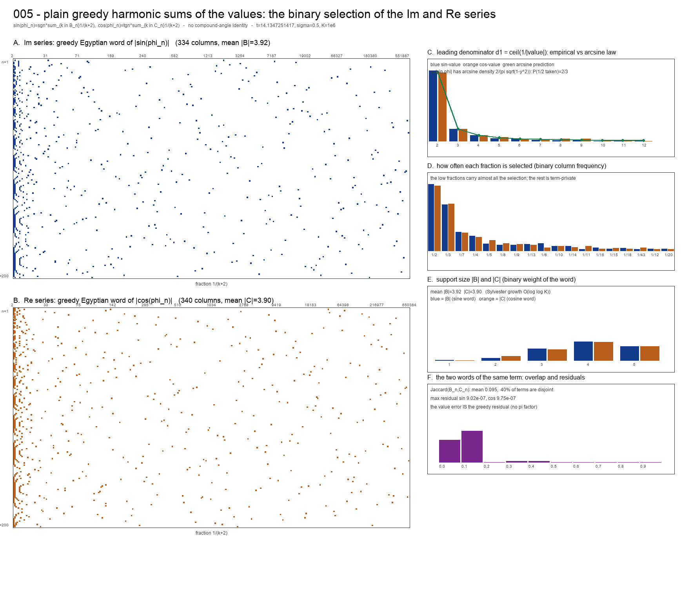

# 005 — Plain greedy harmonic sums of the values: the Re and Im series without the angle-addition identity

This note answers a direct request: build the **Im series** by plainly adding up a greedy
harmonic sum to each Im term, and the **Re series** the same way from the cosine of each
term — *without* the compound-angle (cosine-addition) identity that 004 used to get both
components out of one angle word. The result is two **independent** binary selections per
term, whose distribution is the subject of the HTML illustration.

Files: script [`value_greedy.py`](value_greedy.py), figure
[`value_greedy.png`](value_greedy.png), interactive page
[`value_greedy.html`](value_greedy.html), selector matrices
[`value_greedy_im.tsv`](value_greedy_im.tsv) and [`value_greedy_re.tsv`](value_greedy_re.tsv).
Annex on the arc pattern: [`arcs_explained.py`](arcs_explained.py) /
[`arcs_explained.png`](arcs_explained.png), §8 below. Annexes on monotonicity:
[`tau_regularisation.py`](tau_regularisation.py) / [`tau_regularisation.png`](tau_regularisation.png)
(§9) and [`monotone_alphabet.py`](monotone_alphabet.py) /
[`monotone_alphabet.png`](monotone_alphabet.png) (§10). Interactive lab:
[`monotone_lab.html`](monotone_lab.html).
Context: [`../004/eta-cos-sin.md`](../004/eta-cos-sin.md) (the angle-word version) and
[`../004/eta-cos-sin.md`](../004/eta-cos-sin.md) §8 (what this can and cannot do).



*Parameters: `s = 1/2 + iγ₁`, `γ₁ = 14.134725141734693790…`, terms `n = 1..200`,
truncation `K = 10⁶`. The matrices are drawn for `n = 1..200`; the HTML lets `N` and `t` change.*

---

## 1. The construction

Write `s = σ + it`, `φ_n = t log n`, and the eta function split as in 004:

```
Re η(σ+it) =  Σ_{n≥1} (−1)^{n−1} n^{−σ} cos φ_n          (the Re series)
Im η(σ+it) = −Σ_{n≥1} (−1)^{n−1} n^{−σ} sin φ_n          (the Im series)
```

**The greedy harmonic sum of a value.** For any `y ∈ [0,1]` define the greedy Egyptian
word `E(y) = (δ_k(y))_{k≥0}` by the residual rule

```
r_0 = y,     δ_k(y) = 1  ⟺  r_k ≥ 1/(k+2),     r_{k+1} = r_k − δ_k(y)/(k+2).
```

Then `y = Σ_{k≥0} δ_k(y)/(k+2)` exactly, and truncating at `K` leaves the residual
`r_K < 1/(K+2)`. This is the classical greedy (Sylvester/Fibonacci) Egyptian expansion;
the alphabet `1/2, 1/3, 1/4, …` is the "harmonic" alphabet. **No angle is added and no
trigonometric identity is used** — `y` is a number and the sum adds numbers.

**Apply it to each value.** With `sgn_n = sign(sin φ_n)` and `tgn_n = sign(cos φ_n)`:

```
sin φ_n = sgn_n · Σ_{k∈B_n} 1/(k+2) + sgn_n · r_n^s ,      B_n = E(|sin φ_n|),
cos φ_n = tgn_n · Σ_{k∈C_n} 1/(k+2) + tgn_n · r_n^c ,      C_n = E(|cos φ_n|),
```

with `r_n^s, r_n^c < 1/(K+2)`. Substituting, the two series become **plain sums**:

```
Im η(σ+it) = − Σ_{n≥1} (−1)^{n−1} n^{−σ} sgn_n  Σ_{k∈B_n} 1/(k+2)  +  E_Im
Re η(σ+it) =   Σ_{n≥1} (−1)^{n−1} n^{−σ} tgn_n  Σ_{k∈C_n} 1/(k+2)  +  E_Re
```

with `|E_Im| ≤ Σ_n n^{−σ} r_n^s` and `|E_Re| ≤ Σ_n n^{−σ} r_n^c`. Each term of each
series is now literally a **signed sum of unit fractions** — a linear expression. There
are no products of elementary sines and cosines, no subset sum, and no angle addition.

## 2. What is different from 004, and what is not

| | 004 (angle word) | 005 (value words) |
|---|---|---|
| expanded object | the angle `θ_n/π` | the values `\|sin φ_n\|`, `\|cos φ_n\|` |
| words per term | **one**, `A_n`, shared by Re and Im | **two**, `B_n` and `C_n`, independent |
| how Re and Im are obtained | compound-angle identity (the collapse), then products | independent greedy sums of numbers |
| form of each term | sum over subsets of products of `sin α_k`, `cos α_k` | linear sum of unit fractions |
| value error | `≤ π r_n` (mean-value theorem) | **exactly** `r_n` |
| input density of the quantizer | `x_n = θ_n/π` uniform on `[0,1]` | `\|sin φ_n\|` arcsine on `[0,1]` |
| sign data per term | one sign `ε_n` | two signs `sgn_n`, `tgn_n` |

What is **not** different: both are rewritings of the same `η`, both need the phase (here
the value) known before the word can be computed, and neither carries arithmetic
information. The greedy Egyptian expansion is classical; nothing here is new
mathematics.

## 3. The binary selection

Define the binary selectors

```
δ^sin_{n,k} = 1  ⟺  k ∈ B_n ,        δ^cos_{n,k} = 1  ⟺  k ∈ C_n .
```

Panels A and B of the figure are the two `n × k` matrices at `t = γ₁`, black = 1,
white = 0. Over the first 200 terms there are **334** distinct fractions in the sine
selection and **340** in the cosine selection; the mean binary weight is
`mean |B_n| = 3.925` and `mean |C_n| = 3.895` (max 5 each), the usual Sylvester
`O(log log K)` growth.

The two words of the *same* term overlap only weakly:

| quantity | value (200 terms, `γ₁`) |
|---|---|
| mean Jaccard `\|B_n ∩ C_n\| / \|B_n ∪ C_n\|` | 0.095 |
| terms with `B_n ∩ C_n = ∅` | 40.0 % |
| shared mass carried by `1/2` and `1/3` | almost all of it |

This is the price of dropping the identity: in 004 the sine and cosine of a term shared
**one** word exactly; here they have two words that need not agree. The only relation
between `B_n` and `C_n` is the value identity `sin²φ + cos²φ = 1`, which is not visible
in either word separately.

The selection is concentrated exactly as in 004:

```
 fraction   #terms sin   #terms cos
 1/2           137          133
 1/3            95           96
 1/7            38           37
 1/4            30           28
 1/5            14           21
 then rapidly thinning to term-private fractions
```

## 4. The distribution of the selection

The selection is a **quantizer of the value**: `y ↦ (δ_k(y))_k` is the greedy Egyptian
word map, so it is injective before truncation and many-to-one after it, with cells that
are intervals of `[0,1]` (the same cell-partition picture as
[`../004/eta-cos-sin.md`](../004/eta-cos-sin.md) §2c, now on the value variable).

**The input density is arcsine, not uniform.** Because `{t log n mod 2π}` is
equidistributed, `y = |sin φ_n|` has the arcsine law on `[0,1]`:

```
f(y) = 2 / (π √(1 − y²)) ,        F(y) = P(|sin φ| ≤ y) = (2/π) arcsin y .
```

(`|cos φ|` has the same law.) The first selected denominator is `d₁ = ⌈1/y⌉`, so the
leading-digit law is explicit:

```
P(d₁ = d) = (2/π) ( arcsin(1/(d−1)) − arcsin(1/d) ) ,      d ≥ 2 ,
```

in particular `P(1/2 is selected) = P(y ≥ 1/2) = 2/3`. Empirical (200 terms at `γ₁`):

| `d` | 2 | 3 | 4 | 5 | 6 | 7 | 8 | >12 |
|---|---|---|---|---|---|---|---|---|
| sin-value count/200 | 137 (0.685) | 23 (0.115) | 11 (0.055) | 5 (0.025) | 5 (0.025) | 2 | 1 | 10 (0.05) |
| cos-value count/200 | 133 (0.665) | 23 (0.115) | 11 (0.055) | 7 (0.035) | 3 | 2 | 4 | 13 (0.065) |
| arcsine prediction | 0.6667 | 0.1170 | 0.0555 | 0.0327 | 0.0216 | 0.0153 | 0.0115 | 0.053 |

The agreement is the check that the selection is doing what the theory says it should:
the binary distribution of the selection is a *distributional* fact about the value's
arcsine law, not about `ζ`.

**The words are slightly longer than the angle words.** Under the uniform angle measure
of 004 the mean support is `3.575` (the figure quoted as `3.58` in
[`../004/eta-cos-sin.md`](../004/eta-cos-sin.md) §2b); under the arcsine value measure it
is `3.931`. The arcsine law puts more mass near `0` (where the greedy expansion needs more
terms), so the value words cost about `+0.36` fractions per term. Measured directly by
Monte Carlo at `K = 10⁶`:

| input law | mean support size | `P(1/2 selected)` |
|---|---|---|
| uniform `x` (004, angle word) | 3.575 | 0.500 |
| arcsine `\|sin φ\|` (005, sine word) | 3.931 | 0.668 |
| arcsine `\|cos φ\|` (005, cosine word) | 3.933 | 0.668 |

## 5. Numerical verification

| `M` | `Im η_M` direct | `Im` value sum | diff | `Re η_M` direct | `Re` value sum | diff |
|---|---|---|---|---|---|---|
| 10 | 0.186662737184 | 0.186662871494 | 1.3·10⁻⁷ | 0.058083009509 | 0.058083075854 | 6.6·10⁻⁸ |
| 50 | −0.063679532984 | −0.063679598726 | 6.6·10⁻⁸ | −0.031515112943 | −0.031514656285 | 4.6·10⁻⁷ |
| 100 | 0.036205780558 | 0.036205631316 | 1.5·10⁻⁷ | 0.034481836155 | 0.034482055742 | 2.2·10⁻⁷ |
| 200 | −0.016083196652 | −0.016083397705 | 2.0·10⁻⁷ | −0.031460422459 | −0.031460472386 | 5.0·10⁻⁸ |

The differences are the accumulated greedy residuals. The measured maxima are
`max r_n^s = 9.02·10⁻⁷` and `max r_n^c = 9.75·10⁻⁷`, against the bound
`1/(K+2) = 1.00·10⁻⁶`, and the observed series differences sit below
`Σ_{n≤M} n^{−σ} r_n`, as they must. Everything is float64; the only approximation is the
truncation `K`, exactly as in 004.

## 6. Implications

1. **The compound-angle identity is avoidable.** Both `Re η` and `Im η` can be written as
   plain, linear sums of unit fractions, one greedy word per component, with no angle
   addition anywhere. The subset-product / collapse machinery of 004 is a choice, not a
   necessity: it buys *one* word per term instead of two, at the cost of products.

2. **Linearity is a bookkeeping gain, not a computational one.** Each series is
   `Σ_n (scalar) × (sum of unit fractions)`, errors add linearly, and the per-term error is
   exactly the greedy residual `r_n < 1/(K+2)` (004 paid `π r_n` by the mean-value
   theorem). But the representation is strictly *downstream* of the value: the word cannot
   be built without first evaluating `sin φ_n` to `~1/K`. The series error is
   `≤ Σ_{n≤M} n^{−1/2} r_n ≈ 2√M/K`, which **diverges in `M` at fixed `K`** — so the
   `π → 1` saving is a constant factor, and the direct alternating sum (error `~10⁻¹⁶`,
   cost `M`, no `K`) beats it outright. An adversarial review established this; the
   representational claim survives, the practical claim does not.

3. **Two words, not one, and they barely agree.** `mean Jaccard(B_n, C_n) = 0.095`,
   `40 %` disjoint. The shared part is carried almost entirely by `1/2` and `1/3`. So a
   claim that "the term uses fractions `{…}`" is ambiguous in this representation: the
   sine and the cosine of the same term generally use different fractions.

4. **The selection law is classical and explicitly computable.** Because the input is the
   *value*, the density is arcsine and the leading-digit law is
   `P(d₁=d) = (2/π)(arcsin(1/(d−1)) − arcsin(1/d))`, giving `P(1/2) = 2/3`, matching the
   data to three decimals. This is the digit law of the Sylvester/Egyptian expansion, not
   a zeta phenomenon.

5. **Nothing arithmetic is added.** The word is a function of the value `sin(t log n)`,
   hence of the phase `t log n`, hence of `n`; it reads no factorisation. The parity
   discussion of [`../004/eta-cos-sin.md`](../004/eta-cos-sin.md) §8b applies verbatim:
   index parity only, `Ω`-parity blind, no `λ(n)` or `μ(n)`.

6. **It is still not a zero generator.** As in 004 §8a, the word is *computed from* the
   value it represents, so the representation presupposes the direct evaluation of
   `sin φ_n` and `cos φ_n`; it is more expensive than evaluating `n^{−s}` directly, and
   the series is a rewriting of `η`. The zeros are found by evaluating `η`, not by reading
   the selection.

7. **It connects to the programme's own budget picture.** The alphabet `1/2, 1/3, …` and
   the sub-sums of half-series are exactly the objects of
   [`../dictionary/02-greedy-harmonic-sine.md`](../dictionary/02-greedy-harmonic-sine.md)
   §5 (`P(p) = 2^{−p}ζ(p)`, `N(p)`, Brown's criterion). The value-greedy words here are
   the Sylvester words on that alphabet; the "binary distribution of the selection" is the
   digit law of that expansion, and the reachability questions of the dictionary are the
   right frame for what a given set of selected fractions can sum to.

8. **What would change the picture.** The construction is value-driven and therefore
   amplitude-blind in the same way as 004: only the phase `t log n` enters the selection.
   Any attempt to make the selection see `Ω(n)` would have to feed a factorisation into
   the word, which this alphabet does not do.

## 7. Reproduction

```bash
/Users/victor/.dsh/dsh-runtimes/dsh-primary-runtime/dependencies/python/bin/python3 \
    research/twin-prime-parity/005/value_greedy.py
```

The script prints the two series (direct vs value), the support-size and residual
statistics, the leading-denominator table against the arcsine prediction, the
most-selected fractions, the `B`/`C` overlap, and the first 20 terms' two words; it writes
[`value_greedy.png`](value_greedy.png) and the two selector TSVs. The interactive
[`value_greedy.html`](value_greedy.html) re-implements the same greedy rule in JavaScript
and draws both binary matrices with `t`, `σ` and `N` sliders, the leading-denominator
distribution against the arcsine law, the support-size histogram, the per-fraction
frequency, and the `B`/`C` overlap histogram. It is self-contained; open it from disk.
Its core was checked against the Python words for all 200 terms (0 differing cells).

*Status — DEFINITION/THEOREM: the greedy Egyptian expansion of a value in `[0,1]`, its
exactness, the residual bound `r_K < 1/(K+2)`, and the arcsine law of `|sin φ|` under an
equidistributed phase (equidistribution of `{t log n}` is classical; see
[`../004/eta-cos-sin.md`](../004/eta-cos-sin.md) §2b). NUMERICAL: every table, both
selector matrices, the overlap statistics, and the series comparisons (all at `γ₁`,
`K = 10⁶`, `N ≤ 200`). REMARK: the implications of §6.*

---

## 8. Annex — why the binary selection shows periodic "(((" arcs

Zooming into the Im matrix (rows `n ≈ 40..90`) shows a family of nested **"((("** arcs,
repeating down the picture. They are neither noise nor arithmetic: they are the **lobe
structure of the phase**.

Since `|sin|` has period `π`, put `w_n = φ_n mod π ∈ [0,π)`. Then exactly

```
y_n = |sin φ_n| = sin w_n .
```

A **lobe** is one traversal of `w` from `0` to `π` (the value rises `0 → 1 → 0`). Within a
lobe the first greedy denominator is

```
d₁ = max(2, ⌈ 1 / sin w ⌉ ),
```

verified for all 240 terms in [`arcs_explained.py`](arcs_explained.py). It is `2` at the
lobe centre (`w = π/2`) and grows without bound at the edges. Removing `1/d₁` leaves the
residual `r₁ = sin w − 1/d₁`, and the second take `d₂ = ⌈1/r₁⌉` traces the *same* shape
shifted to the right; `d₃`, `d₄`, … the same again. So:

> one lobe ⟶ one nested family of arcs, the `j`-th arc being the locus of the `j`-th greedy
> take; the whole nest is repeated once per lobe.

That is the "(((" pattern, and its width is the support size (≈ 4–5 arcs per lobe).

**The periodicity is in `log n`, not in `n`.** Since `φ_n = t log n`, the phase advances by
`π` when `n` is multiplied by

```
e^{π/t} = 1.248897…       (t = γ₁),
```

so lobes recur **geometrically**. On a linear `n` axis the nest therefore stretches: the
first lobes (small `n`) are narrow and later ones are wide. On a `log n` axis the pattern
is exactly periodic. Panel A of [`arcs_explained.png`](arcs_explained.png) shows this
directly, panel B shows the take-loci `d₁..d₄` (four nested "(" per lobe), and panel C puts
the lobe boundaries on the binary matrix.

**The solid left edge** is the column `k = 0` (`1/2`): it is taken whenever `y ≥ 1/2`, i.e.
`2/3` of the time (the interval `w ∈ [π/6, 5π/6]`), so it is a nearly solid vertical band,
interrupted once per lobe as `w` passes near the edges.

**Why it matters — it is a statement about `sin`, not about `ζ`.** The arcs are the level
curves of the Sylvester/Egyptian word map composed with `|sin|`. Changing `t` moves where
the lobes fall but never their shape; changing the function (`|sin|` → `|cos|`) shifts the
pattern by a quarter lobe. This is the visual form of the arc-sine picture of §4: the
selection is a function of the value, and the value's lobes are what the eye is reading.

---

## 9. Annex 2 — can τ-intervals or log τ make the word map monotone?

Short answer: the **word** is already lex-monotone; the **digits** are not, and no strictly
monotone coordinate change can fix that; `τ = 1/x` makes the partition combinatorially
regular (a countable-state Markov chain); `log τ` is the wrong logarithm, while
`log log τ` is the right asymptotic coordinate. Figure:
[`tau_regularisation.png`](tau_regularisation.png), script
[`tau_regularisation.py`](tau_regularisation.py). §9.7 records the corrections forced by an
adversarial review; the text below is the corrected version.

### 9.1 The word is monotone; the digits are not

For **any** strictly decreasing positive alphabet obeying the greedy threshold rule —
completeness (Brown's criterion) is *not* needed, nor is positivity, monotonicity, or
`w_k → 0` — the word map is lexicographically non-decreasing. Proof: let `k` be the first
index where `w(x)` and `w(y)` differ, with `w(x)_k = 1`, `w(y)_k = 0`; both share the
prefix `P = Σ_{j<k} w(x)_j`; `x` took `w_k` so `x ≥ P + w_k`, while `y` skipped it so
`y < P + w_k`; hence `x > y`, contradicting `x < y`. Measured: 0 strict lex inversions
over 60 000–200 000 `x`, for every alphabet tested, including non-monotone and
non-complete ones.

What fails is **digitwise** monotonicity. For the harmonic alphabet the exact number of
sign changes of `δ_k(x)` on `(0,1)`, from rational cylinder arithmetic:

| `k` | 0 | 1 | 2 | 3 | 4 | 5 | 6 | 7 | 8 | 9 | 10 | 11 | 12 |
|---|---|---|---|---|---|---|---|---|---|---|---|---|---|
| sign changes | 1 | 3 | 4 | 4 | 4 | 7 | 8 | 8 | 8 | 8 | 8 | 12 | 12 |

`δ_1 = 1, 0, 1` at `x = 1/3, 1/2, 5/6` is the `k = 1` instance.

**The general obstruction (running-minimum theorem).** If index `k` is a *strict running
minimum*, `w_k < μ := min_{j<k} w_j`, then `δ_k` is **not** monotone. Proof: (i) `δ_k ≡ 0`
on `(0, w_k)` — every earlier weight exceeds `x`, so all are skipped and `r_k = x < w_k`;
(ii) `δ_k ≡ 1` on `[w_k, μ)` — again all earlier are skipped, but now `r_k = x ≥ w_k`;
(iii) at `x = μ` the first index attaining `μ` is taken, the residual is `0`, so
`δ_k(μ) = 0`. Hence `{δ_k = 1}` contains `[w_k, μ)` but omits `(0, w_k)` (not a prefix)
and omits `μ` (not a suffix). ∎

Consequences:

* strictly decreasing alphabets: every `k ≥ 1` is a strict running minimum, so **only
  `δ_0` is monotone** — the maximum number of simultaneously monotone digits is 1,
  independent of the schedule;
* if `w_k → 0` there are infinitely many strict running minima, hence infinitely many
  non-monotone digits; "all digits monotone" requires `inf_k w_k > 0` (e.g. a constant
  alphabet, which gives `δ_k = 1_{x ≥ (k+1)c}`);
* ties can make some digits monotone: for a block schedule `w_k = 1/(⌊k/L⌋+2)` the top
  index of each block is still a strict drop and stays non-monotone, but the others can be
  constant. For `L = 2`, `w = (1/2, 1/2, 1/3, 1/3, …)`, **every odd digit is identically
  0** (exact, over the full cylinder partition).

### 9.2 Why a coordinate change cannot fix the digits

A strictly monotone `τ = φ(x)` with interval image maps monotone pieces to monotone
pieces, so the number of monotone pieces of `δ_k` is invariant; measured, the sign-change
counts of `δ_k` are identical in `x` and in `τ = 1/x` for every `k`. A *non-monotone*
bijection of `(0,1)` can, by contrast, merge the two pieces of `{δ_1 = 1}`. So "τ-intervals
cannot make the digits monotone" holds **only** for strictly decreasing alphabets and
strictly monotone coordinate changes. It is **false** if "τ-intervals" means re-scheduling
the alphabet on blocks: the `L = 2` schedule above makes `δ_1` — and every odd digit —
identically 0. That is a change of *alphabet*, not of coordinate, and the invariance
argument says nothing about it.

### 9.3 What `τ = 1/x` does do

Put `τ = 1/x`, and let `n_j` be the `j`-th denominator. Exact-rational verification over
25 530 `(x, j)` pairs, 0 mismatches:

```
n_1      = ⌈τ⌉ = m                    constant on the cells (m−1, m]
T(τ)     = m·τ/(m − τ)  on (m−1, m]   strictly increasing, maps onto (m(m−1), ∞)
τ_j      = T(τ_{j−1}),   n_{j+1} = ⌈τ_j⌉
```

The clamp `n_{j+1} ≥ n_j + 1` is **never binding** (0 of 25 530): from
`n_j − 1 < 1/r_{j−1} ≤ n_j` one gets `r_j < 1/(n_j(n_j−1))`, hence `⌈1/r_j⌉ ≥ n_j + 1`
automatically. The admissible words are exactly the **Sylvester condition**
`n_{j+1} ≥ n_j(n_j−1) + 1` — a one-sided **countable-state topological Markov chain**.
That is the precise, and essentially maximal, regularity: cylinders are intervals, each
digit is constant on depth-`(k+1)` cylinders, and `n_{j+1}` is monotone on each depth-`j`
cylinder. Two caveats:

1. The map is **totally dissipative**: `T(τ) − τ = τ²/(m−τ) > 0` and `T(τ) > 2` for
   `τ > 1`, so every orbit tends to `+∞`; there are no periodic points, no recurrence, no
   induced map, and **no nonzero σ-finite invariant measure**. The regularity is
   combinatorial, not measure-theoretic — "regular interval map" in the ergodic-theory
   sense would be misleading.
2. The standard name belongs to the *expansion* (the Sylvester expansion, equivalently
   greedy Egyptian fractions); the map `T` has no citation-quality standard name. The
   **Engel** expansion is a different system and is not conjugate to this one: its
   preimage tree of `0` is locally infinite where the Sylvester tree is locally finite
   (`≈√n` preimages of `1/n`).

### 9.4 `log τ` versus `log log τ`

The digit boundaries sit at `τ = m`, so in `log τ` the cells have lengths
`log((m+1)/m) ~ 1/m`. That alone does not single out `log log τ` (its cells shrink
faster, `~1/(m log m)`); the real reason is the dynamics `T ~ τ²`:

```
ln ln T(τ) = ln ln τ + ln 2 + o(1),
```

so `v = ln ln τ` is the coordinate in which the map is asymptotically a translation by
`ln 2` — one digit per `ln 2` of `v`. The constant `1/ln 2 = 1.4427…` is the slope of
**depth in `v`**, not an identity for the support size: support size is **not** a function
of `log log(1/x)` at all (`x = 1/N` has support size 1 for every `N`). The correct
statements: the depth at which the residual falls below `ε` is
`≤ (1/ln 2) ln ln(1/ε) + O(1)`, and for a.e. `x`, `ln ln(1/r_j) = j ln 2 + O(1)`.

### 9.5 The Tau alphabet

`α_n = (−1)^n/(n+2)^p` with the sign-matched rule: for `x > 0` every take is at an even
index (parity lock; verified for `p ∈ {0.5, 1, 1.5, 2, 3}`). The positive terms are
`α_{2k} = 2^{−p}(k+1)^{−p}`, so the signed rule at target `x` **is** the unsigned greedy on
`a_k = 2^{−p}(k+1)^{−p}` at target `x`, equivalently the unsigned greedy on `(k+1)^{−p}` at
target `2^p x` — the two forms are equivalent, but the scaling must not be applied twice.
The digitwise no-go does **not** transfer verbatim: `δ_1 ≡ 0` under the parity lock, so the
signed alphabet is itself a counterexample to "`δ_1` is always non-monotone". What survives
is the reduced statement on the even sub-alphabet. Brown's criterion still gives the
reachability threshold: complete iff `p ≤ p* = 1.7286472389981836…`, and for `p > p*` the
reachable set is `2^{n_min(p)−1}` disjoint intervals, `n_min(p)` the first index with
`a_n ≤ ` tail.

### 9.6 Bottom line

| question | answer |
|---|---|
| word map monotone? | **yes**, lexicographically, for any alphabet obeying the threshold rule |
| digits monotone? | **no** — non-monotone at every strict running minimum; for a strictly decreasing alphabet only `δ_0` is monotone |
| can a coordinate change fix the digits? | **no** (a strictly monotone `φ` preserves piece counts) |
| can re-scheduling the alphabet fix them? | **partly** — block schedules make some (not all) digits constant; the blanket "cannot" is false |
| does `τ = 1/x` help? | **yes combinatorially** — Sylvester admissibility, a countable-state Markov chain, digits monotone on cylinders; but the map is totally dissipative (no invariant measure) |
| does `log τ` help? | **no**; the right coordinate is `v = ln ln τ` (asymptotically affine, slope `ln 2`) |
| does the Tau alphabet help? | not for order; it gives the parity lock and the `p*` reachability intervals |

### 9.7 Corrections from adversarial review

An independent adversarial review (two rounds; a subagent with no shared context) produced
the following. All were re-verified here; the text above is corrected accordingly.

1. Lex-monotonicity (§9.1) does **not** need completeness/Brown — the earlier attribution
   was wrong (the `3^{-(k+1)}` alphabet has `tail/w = 0.5` and still 0 inversions).
2. The sign-change counts first reported were grid artifacts mixing transitions with
   constant blocks; the exact counts are `[1,3,4,4,4,7,8,8,8,8,8,12,…]`.
3. The digitwise obstruction is the **running-minimum theorem**, not an isolated `δ_1`
   witness; and it fails for `w_0 = 1`, for `w_1 ≥ w_0`, for signed alphabets, and
   (partly) for block schedules.
4. The `τ`-cell is `(m−1, m]`, not `[m, m+1)`; the `max` clamp is redundant (0/25 530);
   "Engel/Sylvester" conflates two different expansions.
5. `log log` does not "linearise the number of digits" as a function of `x`; the correct
   statement is about the residual depth, with `ln 2` following from `T ~ τ²`, not from
   shrinking cells.
6. The signed-rule transfer normalisation was stated inconsistently.

*Status — THEOREM: lex-monotonicity for any threshold-rule alphabet; the running-minimum
no-go; the Sylvester admissibility condition and its bijective coding; total dissipation of
`T` (no σ-finite invariant measure); Engel and Sylvester are not conjugate; Sylvester
sparsity and the `ln 2` asymptotics; the parity lock and the Brown thresholds. NUMERICAL:
the exact sign-change counts, the reparametrisation invariance, the `τ`-cell and
return-map checks, the block-schedule digit identities, and the clamp-redundancy count.*

---

## 10. Annex 3 — making every digit monotone: the construction, and its price

The round-2 formulation "all digits monotone is possible **iff** `inf_k w_k > 0`" needs
sharpening. Script [`monotone_alphabet.py`](monotone_alphabet.py), figure
[`monotone_alphabet.png`](monotone_alphabet.png).

**Necessary.** A strict running minimum forces `δ_k` non-monotone (§9.1). If `w_k → 0`
there are infinitely many such indices, so all-monotone requires the running minimum to
stop dropping: `w_k ≥ w_0` for all `k`. That implies `inf_k w_k ≥ w_0 > 0`. So
`inf_k w_k > 0` is necessary.

**Not sufficient.** `w = (0.17, 0.81, 0.44, 0.21, 0.28, 0.72, 0.70, 0.25, …)` has
`inf = 0.17 > 0` and no strict running minimum, yet exactly `δ_2` and `δ_3` are
non-monotone — their supports are middle intervals (`{δ_2 = 1} = [0.61, 0.98)`), neither
prefixes nor suffixes. So `inf w_k > 0` alone gives nothing.

**The construction that works.** The constant alphabet `w_k = c`:

```
δ_k(x) = 1  ⟺  x − k·c ≥ c  ⟺  x ≥ (k+1)c ,
```

i.e. every `δ_k` is the suffix indicator `1_{[(k+1)c, 1)}`. Verified exactly for `c = 3/10`
on all `x = m/600`, `m < 600`, for every `k ≤ 5`; each digit's exact support is a suffix.
A non-constant family that also works (verified on 60/60 random samples, and on
`0.2, 0.3, …, 0.9`): any **non-decreasing** alphabet `w_0 ≤ w_1 ≤ …`.

**The price — exact expansion and monotone digits are mutually exclusive.**

| alphabet | resolution | digits |
|---|---|---|
| `w_k → 0` (harmonic `1/(k+2)`) | `0` — `x = Σ δ_k w_k` exactly | only `δ_0` monotone |
| `inf_k w_k = c > 0` (constant) | `c` — residual `∈ [0, c)`, for ever | every `δ_k` monotone |

With `inf_k w_k = c > 0` the greedy stops once the residual falls below `c`; no matter how
many terms are taken the sum is `x − residual` with `residual ∈ [0, c)`. For the constant
alphabet the residual is exactly `x mod c` and the sum is `c·⌊x/c⌋`. The representation is
therefore a **quantiser with resolution `c`**, many-to-one on cells of width `c`, not an
expansion.

This is the concrete cost behind the running-minimum theorem: the greedy word is useful
precisely because `w_k → 0` gives lossless reconstruction (the `π/(K+1)` phase bound of
004/005), and forcing monotone digits caps the resolution at `c`, independent of `K`. For
a phase target the error floor becomes `c`, so no amount of index refinement recovers it.

*Status — THEOREM: the running-minimum no-go, hence necessity of "no strict running
minimum" (`w_k ≥ w_0`); for the constant alphabet `δ_k = 1_{x ≥ (k+1)c}` exactly, with
residual `x mod c`; the resolution/expansion dichotomy. NUMERICAL: the non-decreasing
family (60/60), the `inf > 0` non-sufficiency witness, and the per-digit exact support
computation in [`monotone_alphabet.py`](monotone_alphabet.py).*

**Interactive lab.** [`monotone_lab.html`](monotone_lab.html) puts the whole §10 argument
under controls: seven alphabet presets (harmonic, power `1/(k+2)^p`, constant `c`,
non-decreasing, block `1/(⌊k/L⌋+2)`, offset `c + 1/(k+2)`, and the `inf > 0` witness) with
sliders for `c`, `p`, `L` and the number of digits `K`. It shows the binary digit matrix,
the exact support structure per digit (interval count, green = monotone), `w_k` with its
running minimum and the strict drops marked, and the residual `x − Σ δ_k w_k` computed at
240 digits. A two-depth test (240 vs 480 digits) labels the residual floor **intrinsic**
(does not shrink with `K`) or **truncation** (→ 0), which separates the constant alphabet
(floor `c`) from the harmonic one. Verified behaviour: harmonic → `1/8` monotone digits
with seven strict drops; constant → `8/8` monotone, floor intrinsic; witness → `6/8` with
*no* strict drops, so `inf w_k > 0` alone is visibly not enough; block `L=2` → the odd
digits identically 0 and the even ones non-monotone; offset → `1/8` (every `k ≥ 1` a strict
drop) despite `inf w_k = c > 0`.

### 10.1 The exact all-monotone bound, and what the debate settled

An adversarial review (two rounds) produced a sharpening that closes the classification
question raised in §10 and supplies the constants. Verified here in exact rational
arithmetic.

**Lemma (monotone ⇒ non-decreasing; positivity needed).** If `w_k > 0` for all `k` and
`c = inf_k w_k`, then for `x < c` every residual satisfies `r_{k−1} ≤ x < c ≤ w_k`, so
`δ_k(x) = 0` for all `k`. Hence a monotone digit is never strictly decreasing: **all
digits monotone ⟺ all digits non-decreasing.** (0 violations in 300 random alphabets.)
This step needs `w_k > 0`; the lex-monotonicity of §9.1 does not, but this does.

**Theorem (packing bound).** If all digits are monotone then the realized words are nested,
so distinct words are `c`-separated, and

```
#distinct words  ≤  ⌈1/c⌉        on x ∈ [0,1) ,        ≤ ⌊1/c⌋ + 1   on [0,1] .
```

Both are **sharp** (attained by the constant alphabet `w_k ≡ c`), and they differ exactly
when `1/c ∈ ℤ`. Verified tight for `c = 1/3, 3/10, 1/4, 2/5`.

**Monotonicity is necessary, not cosmetic.** With `w = (7/8, 9/16)`, `c = 9/16`,
`⌈1/c⌉ = 2`, yet the three words `00, 01, 10` are realized — one strict running minimum at
`k = 2` already breaks the bound. So the bound holds exactly in the all-monotone regime
and fails outside it.

**Scope correction.** The running-minimum theorem (§9.1) is alphabet-general for *positive*
sequences — no monotonicity, completeness or self-similarity — and it is **not** literally
contained in the standard cylinder-interval picture: prefix cylinders are always intervals,
yet a digit can be a middle interval. Witness `w = (3/40, 3/20, 7/10, 27/40)`, where
`δ₄ = 1` exactly on `(0.900, 0.924)`, so `δ₄ = 0,1,0`. What the cylinder picture gives is
the interval/Markov structure; what the theorem adds is the criterion for when a union of
cylinders collapses to a half-line. That is a widening of scope, not of depth.

**The classification is still open.** Necessary: no strict running minimum. Sufficient:
constant (and, verified, non-decreasing). But **non-decreasing is not necessary**:
`w = (3/10, 11/15, 7/15)` is all-monotone and not non-decreasing. A sharp
characterization of "all digits monotone" has not been established here.

**Standard framing, and the honest verdict.** In quantizer language the rule is a
first-order error-feedback (nested / embedded scalar) quantizer, and the packing bound is
the classical `c`-separated bound (Bennett 1948; Zador; Equitz–Cover 1991). In that
framing the theorem is a triviality; the only stateable sentence is that a *nested* code
realizes `O(1/c)` words however many components are supplied, against `2^K` for a generic
alphabet. An adversarial review's verdict, which the record accepts: this is a legitimate
**expository remark** (Monthly / Mathematics Magazine level) with a correct sharp theorem —
**not** a research contribution, and it should be stated without the `ζ`/twin-prime
wrapper, which is irrelevant and would sink any submission.
